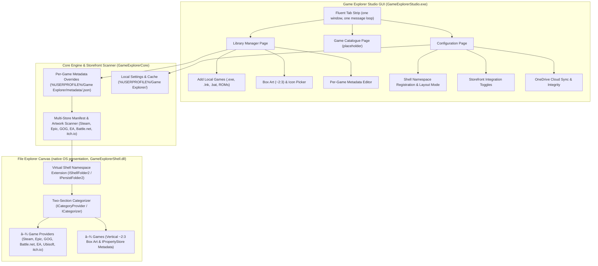

# Architecture — Windows Game Explorer (`projects/windows-game-explorer`)

> Authoritative architectural specification for **Windows Game Explorer** (`projects/windows-game-explorer`).
> Recreates and modernizes the classic Windows 7/Vista Game Explorer (`shell:Games`, `FOLDERTYPEID_Games`) inside Windows 10 1903+ and Windows 11 File Explorer using each OS's native presentation.
> Single-window native Windows architecture: File Explorer Shell Extension (`GameExplorerShell.dll`) + Game Explorer Studio GUI (`GameExplorerStudio.exe`) hosting the Library Manager, Game Catalogue and Configuration pages.
> Generic shortcuts folder degradation is strictly banned by rule.

---

## 1. System Overview & Shell + Studio Paradigm



---

## 2. Directory Map

```text
projects/windows-game-explorer/
├── CMakeLists.txt                  # Top-level native CMake build definition
├── include/
│   └── GameExplorerCore/           # Shared headers (Guid.h, Types.h, StorefrontScanner.h, PlatformLauncher.h, etc.)
├── src/
│   ├── core/                       # Core static library (GameExplorerCore)
│   │   ├── Storage.cpp             # User-scoped paths (%USERPROFILE%\Game Explorer\)
│   │   ├── Database.cpp            # Native SQLite wrapper
│   │   ├── Settings.cpp            # Integration configuration persistence
│   │   ├── DarkMode.cpp            # Windows 11 DWM dark mode & system accent helpers
│   │   ├── StorefrontScanner.cpp   # Multi-drive storefront & local artwork scanner
│   │   └── PlatformLauncher.cpp    # Storefront client & direct game launch dispatcher
│   ├── shell/                      # Windows Shell Namespace Extension (GameExplorerShell.dll)
│   │   ├── DllMain.cpp             # DLL entry point, GDI+ lifecycle, COM exports
│   │   ├── ClassFactory.cpp/.h     # IClassFactory for CLSID_GameExplorer & CLSID_GameCategorizer
│   │   ├── ShellFolder.cpp/.h      # IShellFolder2, IPersistFolder2, provider & game PIDL enumeration
│   │   ├── CategoryProvider.cpp/.h # ICategoryProvider & ICategorizer ("Game Providers" vs "Games")
│   │   ├── GameItemUI.cpp/.h       # IThumbnailProvider, IShellItemImageFactory, IPropertyStore, IExtractIconW
│   │   ├── ShellView.cpp/.h        # Custom view & sidepane helpers
│   │   ├── Registration.cpp/.h     # HKCU COM, Namespace, and FolderType registration
│   │   ├── Resource.rc             # Embedded controller icons & version resources
│   │   └── GameExplorerShell.def   # Module definition exports
│   ├── studio/                     # Game Explorer Studio frame & tab strip (GameExplorerStudio.exe)
│   │   ├── StudioMain.cpp          # Single window, Fluent tab strip, command-line switches
│   │   └── CataloguePage.cpp       # Game Catalogue page (placeholder)
│   ├── config/                     # Configuration page source (compiled into GameExplorerStudio.exe)
│   │   └── ConfigMain.cpp          # Integration settings, layout mode, storefront toggles
│   └── manager/                    # Library Manager page source (compiled into GameExplorerStudio.exe)
│       └── ManagerMain.cpp         # Library game manager, local game adder, box art & metadata editor
└── tests/                          # Native C++ unit & integration test suite (GameExplorerTests.exe)
```

---

## 3. Data Flow & Execution Pipeline

1. **Automated Storefront & Provider Discovery**: `StorefrontScanner` crawls all mounted drives for installed digital storefronts (Steam, Epic Games, GOG Galaxy, Battle.net, Ubisoft Connect, EA App, itch.io) and harvests their local manifests and box art directly from disk in ~5ms without external third-party scrapers.
2. **Per-Game Metadata Overrides**: The Library Manager page of `GameExplorerStudio.exe` allows adding local games and customizing any game's title, developer, publisher, release date, rating, launch parameters, and box art via `%USERPROFILE%\Game Explorer\metadata\<appId>.json`.
3. **Two-Section In-Shell Categorization**: `ShellFolder` enumerates installed storefront clients (`itemKind = 0`) and games (`itemKind = 1`), while `GameCategoryProvider` and `GameCategorizer` group them into `â–¾ Game Providers (N)` and `â–¾ Games (N)` inside File Explorer.
4. **Authentic Launch Delegation**: Launching a provider opens the storefront client; launching a game invokes the official platform client (`steam.exe -applaunch <appId>`, etc.) or direct executable for DRM-free titles.
