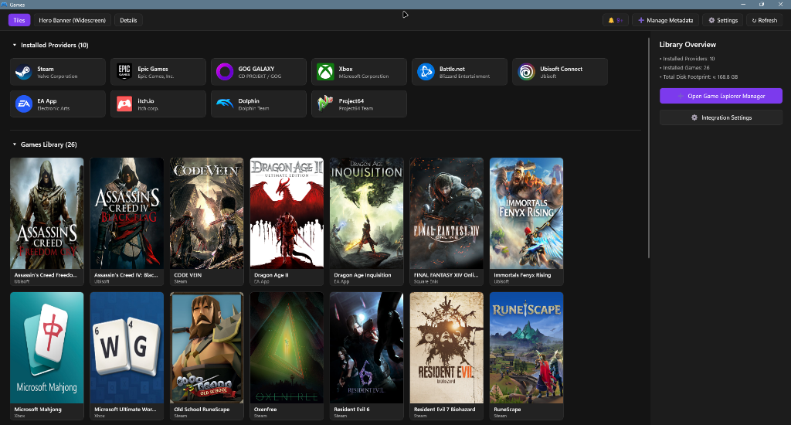

<div align="center">

# Windows Game Explorer

<p align="center">
  <a href="https://github.com/HELIX-Origin/windows-game-explorer/releases"></a>
  <a href="https://opensource.org/licenses/MIT"></a>
  
  
</p>

**A native C++20 Windows Shell Extension reviving the classic Windows 7/Vista Game Explorer experience directly inside Windows 10 & 11 File Explorer.**

Organize, browse, and launch your entire multi-platform game library with high-resolution vertical box art, responsive widescreen hero banners, an inspector sidepane, and automated storefront detection—with zero external scrapers required.

<br />



</div>

---

## 🌟 Key Capabilities

- **Native File Explorer Integration**: In-process shell extension (`GameExplorerShell.dll`) hosting WinUI 3 XAML Islands with full Windows 11 tabbed UI support.
- **Two-Section Organization**: Structured grouping into collapsible `▾ Installed Providers` and `▾ Games Library` sections.
- **Multi-Viewport Presentation**: Seamless switching between 2:3 vertical Cover Art (SteamGridDB standard), 3.1:1 widescreen Hero Banners, and 1:1 Details icon lists.
- **Storefront-First Discovery**: Automatically detects installed titles and native art from Steam, Epic Games, GOG Galaxy, Ubisoft Connect, EA App, Battle.net, Xbox/Game Pass, Itch.io, Amazon Games, and retro ROMs.
- **Owned-Games Catalogue**: A paged, filterable list of every game you own — installed or not — merged across Steam, Epic, GOG, itch.io, Xbox, Ubisoft, and installed-storefront scanners. A Windows-installable gate keeps non-PC titles out, and installs are delegated to each storefront's own client.
- **Artwork Discovery Hub**: Game Explorer Studio (`GameExplorerStudio.exe`) with a multi-provider visual search gallery (SteamGridDB, Steam Store, IGDB, and internal Web search) with SafeSearch/NSFW unblock.
- **Universal Achievements & Cloud Sync**: Live trophy cards with progress bars and automated OneDrive backup snapshots (`backups/`, `metadata/`, `art/`).

---

## 📚 Documentation

Detailed user guides, engineering specifications, and customization references are available in the [`docs/`](./docs/README.md) folder:

- **[Project Overview & Architecture](./docs/overview.md)** — Core design philosophy, system architecture, and supported platform breakdown.
- **[Quick Start Guide](./docs/quick-start.md)** — Installation methods, navigation pane entry points, and first-time library setup.
- **[Comprehensive User Guide](./docs/user-guide.md)** — Deep-dive manual for the Library Manager, Game Catalogue, Configuration, Artwork Discovery, ROMs, and cloud sync.
- **[Developer & Technical Reference](./docs/developer-guide.md)** — WinUI 3 XAML Islands internals, C++20 core engine, SQLite schema, build gates, and test suites.
- **[Metadata & Customization Guide](./docs/metadata-customization.md)** — JSON schema specification for per-game overrides and manual imports.

---

## ⚡ Quick Start & Development

### Prerequisites
- Windows 10 (1903+ / Build 18362+) or Windows 11 (Build 22000+) *(earlier Windows versions are not supported due to modern XAML shell architecture)*
- Visual Studio 2022 / Build Tools (MSVC v143+ with C++20)
- CMake 3.25+

### Building & Testing
```powershell
# One dispatcher owns every workflow command
.\game-explorer.bat build Release     # Fast incremental build (/W4 /WX zero-warning gate)
.\game-explorer.bat test Release      # Run the 61-test automated C++ unit test suite
.\game-explorer.bat release           # Build, test, lint, and package installer + portable ZIPs
.\game-explorer.bat help              # List every command and option
```

---

## 🤝 Community & Governance

- [Contributing](./CONTRIBUTING.md) · [Code of Conduct](./CODE_OF_CONDUCT.md) · [Support](./SUPPORT.md)
- [Security Policy](./SECURITY.md) · [Privacy Policy](./PRIVACY.md) · [Terms of Service](./TOS.md)
- [Changelog](./CHANGELOG.md) · [Governance](./GOVERNANCE.md) · [Citation](./CITATION.cff) · [License](./LICENSE)

---

## ⚖️ License

[MIT](LICENSE) — Copyright (c) 2026, HELIX Origin.
