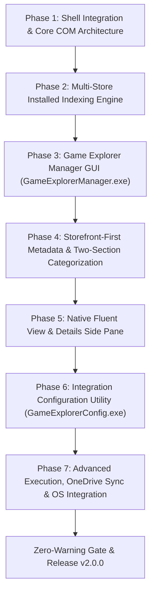

# Windows Game Explorer — Roadmap & Milestones

> 🗺️ **Living Source of Truth**: Product direction, positioning principles, and milestone delivery history for **Windows Game Explorer** (`projects/windows-game-explorer`).
> Pair with [`PLAN.md`](./PLAN.md) (sprint execution), [`TODO.md`](./TODO.md) (task ledger), and [`BUGS.md`](./BUGS.md) (issues and quirks).

---

## 📜 Tracking Rules

- **100% Active Direction Accuracy**: `ROADMAP.md`, `PLAN.md`, `TODO.md`, and `BUGS.md` reflect the current, active state of Windows Game Explorer with zero contradictions.
- **Self-Contained Repository Memory**: Windows Game Explorer tracks its own product roadmap and development sprints independently.
- **Game Library Experience Invariant**: Must deliver an authentic, rich game library (two-section categorization, vertical box art, preview/details integration, metadata properties); generic shortcuts folder degradation is strictly rejected.
- **Mandatory Quality Gate**: Zero compiler warnings (`MSVC /W4 /WX`, zero warnings treated as errors).
- **License**: Strictly licensed under **MIT**.

---

## 🔭 Vision & Positioning Principles

1. **Core Value Proposition**: Completely native to Windows. Recreates the classic Windows 7/Vista Game Explorer (`shell:Games`, `FOLDERTYPEID_Games`) directly inside the modern Windows 11 File Explorer canvas as a native Virtual Shell Namespace Extension (C++20, Win32 APIs, COM). Built with a dedicated triple-component architecture:
   - **`GameExplorerShell.dll`**: In-process File Explorer shell extension presenting two collapsible sections (`▾ Game Providers (N)` and `▾ Games (N)`) with vertical ~2:3 box art and rich properties.
   - **`GameExplorerConfig.exe`**: Lightweight Win32 configuration utility dedicated strictly to configuring the shell integration (enable/disable namespace registration, layout mode preference, storefront integration toggles, and OneDrive cloud sync).
   - **`GameExplorerManager.exe`**: Separate Win32 GUI application alongside `GameExplorerConfig.exe`, reviving the classic Game Explorer Manager (GEM) utility for managing games in the library, adding local/custom games, picking box art/icons, and editing game metadata.
2. **Design Principles**:
   - **Automated Storefront-First Discovery (No External Scrapers)**: Automatically detects and indexes titles and storefront providers directly from installed storefronts on disk (Steam, Epic Games, GOG Galaxy, Battle.net, EA App, Ubisoft Connect, itch.io) without manual XML/GDF registration or external third-party scrapers (IGDB, SteamGridDB, VNDB).
   - **Authentic Two-Section Categorization**: Implements `ICategoryProvider` and `ICategorizer` on `PKEY_ItemTypeText` to group installed storefront clients under `▾ Game Providers` and installed game titles under `▾ Games`.
   - **Native App & File Isolation**: Never writes to, modifies, or corrupts external launcher proprietary files (`shortcuts.vdf`, etc.). Local metadata overrides, indices, and settings persist cleanly in `%USERPROFILE%\Game Explorer\`.
   - **Zero In-App Transactions**: Installations, updates, launches, and purchases delegate strictly to official storefront clients, system protocols, or direct binary execution.
   - **Cloud Sync**: Decentralized profile backups leveraging the user's local OneDrive sync directory with availability and sync validation.

---

## 🗺️ Milestone Overview

| # | Milestone | Scope | Status | Version / Target | Focus |
|---|---|---|---|---|---|
| **M15** | Windows Game Explorer Shell Extension & Native Re-Architecture | Shell extension & Win32 apps | ✅ Released | `v2.0.0` | Native C++20 Win32 COM virtual namespace extension (`GameExplorerShell.dll`), two-section categorization (`Installed Providers` & `Games Library`), 17-platform scanner, `GameExplorerConfig.exe`, and `GameExplorerManager.exe` |
| **M16** | Universal Multi-Source Achievement Tracking & Multi-Viewport Artwork Engine | Core, Shell & Config | ✅ Delivered | `v2.2.0` | Hybrid native storefront + external tracker integration (RetroAchievements, Steam Web API, GOG Galaxy), VNDB Kana API provider, itch storefront scraping, multi-viewport aspect ratio fitting, cache purge & rebuild engine, in-place scroll preservation, write-only OneDrive backup, config UI, and Inspector trophy rendering |

---

## 🚀 Active Milestones

### [windows-game-explorer] — Milestone M15: Windows Game Explorer Shell Extension & Native Re-Architecture (v2.0.0)

> **Architectural Direction (W.54):** Completely native Windows experience recreating the classic Windows 7/Vista Game Explorer directly inside Windows 11 File Explorer using a native C++20 Win32 Virtual Shell Namespace Extension (`IShellFolder2`, `IPersistFolder2`, `ICategoryProvider`, `IThumbnailProvider`, `IPropertyStore`), paired with `GameExplorerConfig.exe` and `GameExplorerManager.exe`.

#### Detailed Deliverables

- 🎯 **[windows-game-explorer] Phase 1 — Shell Integration & Core Architecture**: Unique CLSID, COM DLL registration (`DllRegisterServer`/`DllUnregisterServer`), pinning as a prominent "Games" node in the File Explorer navigation pane alongside Gallery and Home utilizing a custom Fluent SVG controller icon and full Windows 11 light/dark mode support.
- 🎯 **[windows-game-explorer] Phase 2 — Multi-Store Installed Application Indexing**: Fast local indexing across all mounted drives for Steam (`libraryfolders.vdf`, `*.acf`), Epic Games (`.item` manifests), GOG Galaxy (Registry), Battle.net, EA App, Ubisoft Connect, and itch.io (`butler.db` and drive folders).
- 🎯 **[windows-game-explorer] Phase 3 — Game Explorer Manager Companion GUI App (`GameExplorerManager.exe`)**: Dedicated Win32 management companion reviving the classic Game Explorer Manager (GEM) utility for managing library games, adding custom local games (`.exe`, `.lnk`, `.bat`, ROMs), visual box art and icon selection, full metadata editing, and per-game `%USERPROFILE%\Game Explorer\metadata\<appId>.json` persistence.
- 🎯 **[windows-game-explorer] Phase 4 — Storefront-First Metadata & Native Shell Categorization**: Direct storefront data invariant (no external third-party scrapers), local Steam 600×900 vertical box art and hero banners harvested directly from disk (~5ms scan), and native Windows Shell categorization (`ICategoryProvider`/`ICategorizer`) presenting two distinct collapsible sections in File Explorer (`▾ Game Providers (N)` and `▾ Games (N)`).
- 🎯 **[windows-game-explorer] Phase 5 — Front-End Custom Gallery & Details Side Pane**: Native Fluent Design game view supporting selectable layouts (Cover Art, Hero Banner, Details View), authentic native Windows light and dark styles, keyboard navigation hooks, and contextual details side panel.
- 🎯 **[windows-game-explorer] Phase 6 — Integration Configuration Utility (`GameExplorerConfig.exe`)**: Standalone lightweight Win32 configuration utility dedicated to enabling/disabling shell integration, selecting library layout mode, toggling storefront integrations, and managing OneDrive cloud sync.
- 🎯 **[windows-game-explorer] Phase 7 — Advanced Execution, OneDrive Sync & OS Integration**: Client-executable launch invocation (`steam.exe -applaunch <appId>`, etc.), custom Explorer right-click context menus, and dynamic OneDrive cloud-save backup.

