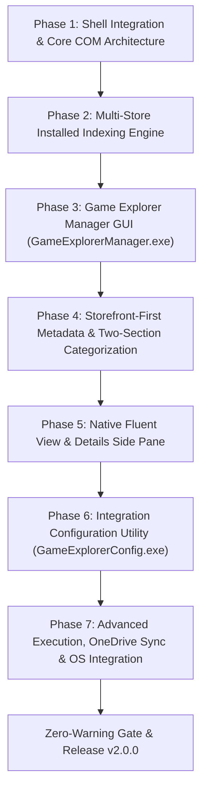

# Windows Game Explorer — Roadmap & Milestones

> 🗺️ **Living Source of Truth**: Product direction, positioning principles, and milestone delivery history for **Windows Game Explorer** (`projects/windows-game-explorer`).
> Pair with [`PLAN.md`](./PLAN.md) (sprint execution), [`TODO.md`](./TODO.md) (task ledger), and [`BUGS.md`](./BUGS.md) (issues and quirks).

---

## 📜 Tracking Rules

- **100% Active Direction Accuracy**: `ROADMAP.md`, `PLAN.md`, `TODO.md`, and `BUGS.md` reflect the current, active state of Windows Game Explorer with zero contradictions.
- **Self-Contained Repository Memory**: Windows Game Explorer tracks its own product roadmap and development sprints independently.
- **Game Library Experience Invariant**: Must deliver an authentic, rich game library (two-section categorization, vertical box art, preview/details integration, metadata properties); generic shortcuts folder degradation is strictly rejected.
- **Mandatory Quality Gate**: Zero compiler warnings (`MSVC /W4 /WX`, zero warnings treated as errors).
- **License**: Strictly licensed under **MIT**.

---

## 🔭 Vision & Positioning Principles

1. **Core Value Proposition**: Completely native to Windows. Recreates the classic Windows 7/Vista Game Explorer (`shell:Games`, `FOLDERTYPEID_Games`) inside Windows 10 version 1903+ and Windows 11 File Explorer as a native Virtual Shell Namespace Extension (C++20, Win32 APIs, COM), using each OS's native Explorer presentation. Built with a dedicated dual-component architecture:
   - **`GameExplorerShell.dll`**: In-process File Explorer shell extension presenting two collapsible sections (`▾ Game Providers (N)` and `▾ Games (N)`) with vertical ~2:3 box art and rich properties.
   - **`GameExplorerStudio.exe`**: The single companion GUI, one custom-chrome window with three tabs — **Library Manager** (library management, local/custom games, box art/icons, metadata editing, artwork discovery), **Game Catalogue** (paged list of every owned storefront game with search/filter/sort toolbar and delegated storefront installs), and **Configuration** (shell integration registration, layout mode preference, storefront integration toggles, API credentials, OneDrive cloud sync). It also owns `--register` / `--unregister` / `--reset-cache`.
2. **Design Principles**:
   - **Automated Storefront-First Discovery (No External Scrapers)**: Automatically detects and indexes titles and storefront providers directly from installed storefronts on disk (Steam, Epic Games, GOG Galaxy, Battle.net, EA App, Ubisoft Connect, itch.io) without manual XML/GDF registration or external third-party scrapers (IGDB, SteamGridDB, VNDB).
   - **Authentic Two-Section Categorization**: Implements `ICategoryProvider` and `ICategorizer` on `PKEY_ItemTypeText` to group installed storefront clients under `▾ Game Providers` and installed game titles under `▾ Games`.
   - **Native App & File Isolation**: Never writes to, modifies, or corrupts external launcher proprietary files (`shortcuts.vdf`, etc.). Local metadata overrides, indices, and settings persist cleanly in `%USERPROFILE%\Game Explorer\`.
   - **Zero In-App Transactions**: Installations, updates, launches, and purchases delegate strictly to official storefront clients, system protocols, or direct binary execution.
   - **Cloud Sync**: Decentralized profile backups leveraging the user's local OneDrive sync directory with availability and sync validation.

---

## 🗺️ Milestone Overview

| # | Milestone | Scope | Status | Version / Target | Focus |
|---|---|---|---|---|---|
| **M15** | Windows Game Explorer Shell Extension & Native Re-Architecture | Shell extension & Win32 apps | ✅ Released | `v2.0.0` | Native C++20 Win32 COM virtual namespace extension (`GameExplorerShell.dll`), two-section categorization (`Installed Providers` & `Games Library`), 17-platform scanner, `GameExplorerConfig.exe`, and `GameExplorerManager.exe` |
| **M16** | Universal Multi-Source Achievement Tracking & Multi-Viewport Artwork Engine | Core, Shell & Config | ✅ Delivered | `v2.2.0` | Hybrid native storefront + external tracker integration (RetroAchievements, Steam Web API, GOG Galaxy), VNDB Kana API provider, itch storefront scraping, multi-viewport aspect ratio fitting, cache purge & rebuild engine, in-place scroll preservation, write-only OneDrive backup, config UI, and Inspector trophy rendering |
| **M17** | Unified Tabbed GUI & Game Catalogue for All Owned Games | Unified companion GUI & Service | ✅ Released | `v2.5.0` | Unified companion app `GameExplorerStudio.exe` (Library Manager, Game Catalogue, Configuration), paged owned-games catalogue with search/filter/sort and delegated installs (Steam, GOG, itch, Xbox, Ubisoft Connect, Epic via optional legendary), Windows-installable gate, edition-aware multi-store deduplication, `GameExplorerService.exe` background service, single `game-explorer.bat` dispatcher, and Windows 10/11 platform bounds |
| **M18** | Windows 10 vs 11 Shell Compatibility Research | Shell extension & Studio | ✅ Complete | TBD | Windows 10 version 1903 (build 18362) is the documented UWP XAML hosting API floor; Explorer retains each OS's native presentation; see `docs/research/windows-version-compatibility.md` |
| **M19** | Shell Performance, Dynamic Resizing & Fluent Iconography | Shell extension, service & scanner | ✅ Released | `v2.6.0` | Standalone responsive dynamic window sizing, automatic navigation pane and status bar suppression, authentic Windows 11 Fluent 3D controller iconography, multi-drive discovery, and storefront-validated artwork |

---

## ✅ Completed Milestones

### [windows-game-explorer] — Milestone M18: Windows 10 vs 11 Shell Compatibility Research (complete)

> **Status: complete.** Microsoft documents Windows 10 version 1903 (build 18362) as the runtime
> floor for the UWP XAML hosting API used by `explorer.exe`; build 19041 is not required by that API.
> The extension leaves Explorer's mode and chrome to the OS, does not delete the OS Games folder
> type, and no longer writes app-specific flags intended to favor Windows 11 tabbed hosting. The
> installer rejects older builds. Explorer-hosted validation on build 18362 remains outstanding;
> findings and the support caveat are in [`docs/research/windows-version-compatibility.md`](./docs/research/windows-version-compatibility.md).

---

## 🚧 Proposed Milestones

### [windows-game-explorer] — Milestone M19: Shell Performance & Explorer Lifecycle

> User-directed scope: optimize performance (`PERF-01`), build an independent project-owned Explorer watcher/loader
> (`HOST-01`) with zero external dependencies, and suppress the left navigation sidebar when launched standalone via `shell:games`
> or shortcuts (`NAV-01`) to maximize installed games grid canvas space. Watcher-managed lifecycle
> loading is the architectural focus. Preserve COM namespace activation, native
> Explorer presentation, multi-user isolation, and reversible installation.
> The active workstreams remain tracked in [`TODO.md`](./TODO.md)
> and Sprint 39 in [`PLAN.md`](./PLAN.md); blockers must not be reported as completed features.

---

## 🚀 Milestone Direction & Delivery Records

### [windows-game-explorer] — Milestone M17: Unified Tabbed GUI & Game Catalogue for All Owned Games (released v2.5.0)

> **Architectural Direction (CAT-01):** Owned-games support is a **separate page in a unified companion
> GUI**, not a shell view and not a standalone executable. The former `GameExplorerConfig.exe` and
> `GameExplorerManager.exe` standalone apps are retired; their UIs now live inside the single
> **Game Explorer Studio** (`GameExplorerStudio.exe`, name confirmed by the user 2026-10-25) and ship as
> **Library Manager**, **Game Catalogue**, and **Configuration** pages. The shell namespace extension is unchanged and stays
> installed-games-only. The catalogue is an extensive, filterable, sortable browser of every game the
> user owns, whose purpose is discovery, installation and installation organization:
>
> - **Storefront-delegated installation** — the catalogue never downloads game content itself; it hands
>   off to the official storefront client through that store's URI protocol.
> - **Install locations belong to the storefront** — the catalogue never creates or manages install
>   folders; a storefront install URI cannot target one, so the client owns where a game lands.
> - **Installed library stays isolated** — the shell namespace remains strictly installed-games-only;
>   owned-but-not-installed titles never appear in Explorer.
>
> Deliverables are tracked as `CAT-01` in [`TODO.md`](./TODO.md).
>
> **Delivery order (user decision 2026-10-25):** the unified tabbed shell ships first, hosting today's
> Library Manager and Configuration pages unchanged plus the Catalogue page. Catalogue data, filtering
> and delegated installs landed in the following slices.

> **Architectural Direction (SVC-01):** the always-running background component is a **true Windows
> service** (user decision 2026-10-25), named **Game Explorer Service** (`GameExplorerService.exe`,
> service key `GameExplorerService`). It runs under the least-privileged **`NT AUTHORITY\LocalService`**
> account — not `LocalSystem` — and its install/start is orchestrated through **Task Scheduler**: the
> elevated installer registers a highest-privileges task that ensures the service is installed, started
> and restarted, so no UAC prompt ever appears at login or at runtime. The service preloads
> library/metadata and keeps achievement and metadata sync warm so the shell view and Studio open
> instantly. Because neither `LocalService` nor a scheduled task has the interactive user's profile,
> every write is routed to the owning session's `%USERPROFILE%\Game Explorer\` through the service↔client
> IPC handshake — the service never assumes `%USERPROFILE%` is its own. Options considered and rejected
> are recorded in [`docs/research/startup-background-service.md`](./docs/research/startup-background-service.md).
>
> Deliverables are tracked as `SVC-01` in [`TODO.md`](./TODO.md).

### [windows-game-explorer] — Milestone M15: Windows Game Explorer Shell Extension & Native Re-Architecture (v2.0.0)

> **Delivery note:** M15 shipped with standalone `GameExplorerConfig.exe` and `GameExplorerManager.exe`. Both were retired in v2.4.0 and their UIs now live as the Configuration and Library Manager pages of `GameExplorerStudio.exe`.

> **Architectural Direction (W.54):** Completely native Windows experience recreating the classic Windows 7/Vista Game Explorer directly inside Windows 11 File Explorer using a native C++20 Win32 Virtual Shell Namespace Extension (`IShellFolder2`, `IPersistFolder2`, `ICategoryProvider`, `IThumbnailProvider`, `IPropertyStore`), paired with `GameExplorerConfig.exe` and `GameExplorerManager.exe`.

#### Detailed Deliverables

- 🎯 **[windows-game-explorer] Phase 1 — Shell Integration & Core Architecture**: Unique CLSID, COM DLL registration (`DllRegisterServer`/`DllUnregisterServer`), pinning as a prominent "Games" node in the File Explorer navigation pane alongside Gallery and Home utilizing a custom Fluent SVG controller icon and full Windows 11 light/dark mode support.
- 🎯 **[windows-game-explorer] Phase 2 — Multi-Store Installed Application Indexing**: Fast local indexing across all mounted drives for Steam (`libraryfolders.vdf`, `*.acf`), Epic Games (`.item` manifests), GOG Galaxy (Registry), Battle.net, EA App, Ubisoft Connect, and itch.io (`butler.db` and drive folders).
- 🎯 **[windows-game-explorer] Phase 3 — Game Explorer Manager Companion GUI App (`GameExplorerManager.exe`)**: Dedicated Win32 management companion reviving the classic Game Explorer Manager (GEM) utility for managing library games, adding custom local games (`.exe`, `.lnk`, `.bat`, ROMs), visual box art and icon selection, full metadata editing, and per-game `%USERPROFILE%\Game Explorer\metadata\<appId>.json` persistence.
- 🎯 **[windows-game-explorer] Phase 4 — Storefront-First Metadata & Native Shell Categorization**: Direct storefront data invariant (no external third-party scrapers), local Steam 600×900 vertical box art and hero banners harvested directly from disk (~5ms scan), and native Windows Shell categorization (`ICategoryProvider`/`ICategorizer`) presenting two distinct collapsible sections in File Explorer (`▾ Game Providers (N)` and `▾ Games (N)`).
- 🎯 **[windows-game-explorer] Phase 5 — Front-End Custom Gallery & Details Side Pane**: Native Fluent Design game view supporting selectable layouts (Cover Art, Hero Banner, Details View), authentic native Windows light and dark styles, keyboard navigation hooks, and contextual details side panel.
- 🎯 **[windows-game-explorer] Phase 6 — Integration Configuration Utility (`GameExplorerConfig.exe`)**: Standalone lightweight Win32 configuration utility dedicated to enabling/disabling shell integration, selecting library layout mode, toggling storefront integrations, and managing OneDrive cloud sync.
- 🎯 **[windows-game-explorer] Phase 7 — Advanced Execution, OneDrive Sync & OS Integration**: Client-executable launch invocation (`steam.exe -applaunch <appId>`, etc.), custom Explorer right-click context menus, and dynamic OneDrive cloud-save backup.
