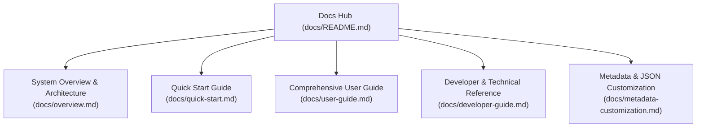

# Windows Game Explorer Documentation Hub

> Complete documentation, architectural specifications, user guides, and developer references for **Windows Game Explorer**.

---

## 📚 Documentation Index

### 1. 🌟 [Project Overview & Architecture](./overview.md)
Learn about the motivation, architectural design, and core philosophy of Windows Game Explorer:
- **Historical Context**: Why reviving the classic Windows 7/Vista Game Explorer in Windows 11 matters.
- **System Architecture**: Shell Extension COM layer, native C++20 core engine, WinUI 3 XAML Islands, and companion applications.
- **Design Principles**: Storefront-first discovery, zero third-party scrapers required, native isolation invariant, and two-section categorization.
- **Supported Platforms**: Steam, Epic Games, GOG Galaxy, Ubisoft Connect, EA App, Battle.net, Itch.io, Amazon Games, Xbox/PC Game Pass, and Retro ROMs.
- **Universal Achievements**: Multi-source achievement tracking with live trophy cards.
- **OneDrive Cloud Sync**: Seamless cross-machine roaming and backup.

### 2. ⚡ [Quick Start Guide](./quick-start.md)
Step-by-step setup for getting started in under two minutes:
- **Installation Methods**: Standard dual-mode NSIS setup (`windows-game-explorer-setup.exe`) and portable standalone archive (`register.bat` / `unregister.bat`).
- **Opening the Explorer**: Launching via the File Explorer navigation pane (pinned **Games** tree item), companion tools, or direct shell GUID.
- **First-Time Discovery**: Running an asynchronous storefront scan to populate your unified game library.
- **Interface Navigation**: Two-section cataloging, layout mode switching (Cover Art, Hero Banner, Details), and direct game launching.

### 3. 📖 [Comprehensive User Guide](./user-guide.md)
Detailed manual covering advanced features and companion tools:
- **Game Explorer Manager (`GameExplorerManager.exe`)**:
  - Three-column UI layout (Library, Properties & Preview, Artwork Discovery Gallery).
  - Standalone game imports (`[ 📁 Browse... ]`) for custom executables, shortcuts, and batch scripts.
  - In-app visual Artwork Discovery Gallery (SteamGridDB, Steam Store, IGDB, and Web image search).
  - Internal Web image search with exact-match keyword templating (`"{{game.title}}" {{content.type}}`) and Patreon media discovery.
  - SafeSearch / NSFW toggle for unblocking mature game artwork across search and providers.
  - Multi-slot artwork application (`Box Art`, `Hero Banner`, `Details Art`, `Icon / Logo`) with instant preview and disk persistence.
  - Clean artwork cache reset (`[ 🧹 Reset Cache ]`) with unlocked GDI+ in-memory stream handles.
- **Game Explorer Configuration (`GameExplorerConfig.exe`)**:
  - Presentation modes and appearance customization.
  - Storefront scan controls.
  - Universal achievement credential management with secure password dot masking (`ES_PASSWORD`).
  - OneDrive cloud synchronization.
- **Retro & Emulation Support**:
  - Automatic multi-drive ROM folder scanning (`<Drive>:\ROMs\<System>\`).
  - Pre-structured empty directory template (`windows-game-explorer-ROMs-template.zip`).
  - Supported emulators (Dolphin, PCSX2, Project64, DuckStation, PPSSPP, RPCS3, mGBA, Snes9x, melonDS, Citra, Flycast, RetroArch).
  - Automatic title cleaning and Libretro Thumbnails CDN integration.

### 4. 🛠️ [Developer & Technical Reference](./developer-guide.md)
Complete engineering reference for contributors and integrators:
- **Codebase Organization**: Target directory breakdown and CMake configuration.
- **WinUI 3 XAML Islands Shell Architecture**: Hosting `DesktopWindowXamlSource` within Win32 `IShellView`, DirectComposition rendering, tab switching lifecycle management, and avoiding `0xc000027b` and `0xc00000fd` exceptions.
- **Core Engine Internals**: Storefront manifest parsing, multi-source `AchievementEngine`, text/mojibake sanitizer (`SanitizeGameText`), and `ImageValidator` aspect-ratio standards.
- **SQLite Database Schema**: Relational schema diagram and field definitions for `games`, `achievements`, and `settings` tables in `library.db`.
- **Build Pipelines & Quality Gates**: Windows 11 SDK prerequisites, MSVC `/W4 /WX /permissive- /utf-8` zero-warning invariant, and root batch automation suite (`build.bat`, `release.bat`, `register.bat`, `unregister.bat`).
- **Unit Testing Architecture**: 20 dedicated C++ unit tests covering database CRUD, storefront discovery, achievement tracking, image validation, and storage sync.
- **Sequence Diagrams**: Navigation, initialization, and asynchronous loading lifecycle.

### 5. 📂 [Metadata & JSON Customization Guide](./metadata-customization.md)
Technical specification for human-readable per-game metadata files:
- Transparent JSON override schema (`%USERPROFILE%\Game Explorer\metadata\<appId>.json`).
- Complete field definitions for title, description, developer, publisher, release date, genres, launch strings, and 4 distinct artwork slots (`coverArtPath`, `heroArtPath`, `detailsArtPath`, `iconPath`).
- Manual editing workflows and local game creation.
