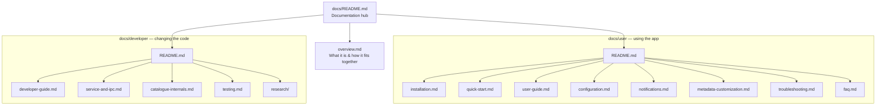

# Windows Game Explorer — Documentation Hub

> Everything about **Windows Game Explorer**: what it is, how to install and use it, and how it is
> built. Start here, then pick the folder that matches what you are doing.

The documentation is split by **audience**:

- **[`user/`](./user/README.md)** — for people using the shipped app: installation, the Studio pages,
  the Game Catalogue, configuration, update alerts, metadata overrides, troubleshooting, FAQ.
- **[`developer/`](./developer/README.md)** — for people changing the code: architecture, shell
  hosting, the background service and its IPC, catalogue/update/notification internals, build gates,
  the test suite, and dated research records.

Two pages sit at the root because both audiences need them:
**[System Overview & Architecture](./overview.md)** and this hub.

---

## 🗺️ Map



---

## 🧑‍💻 If you are using the app

| Step | Page |
|---|---|
| Install it | [Installation & Removal](./user/installation.md) |
| Open it for the first time | [Quick Start](./user/quick-start.md) |
| Learn the Library Manager, Game Catalogue, ROMs and emulators | [User Guide](./user/user-guide.md) |
| Change a setting | [Configuration](./user/configuration.md) |
| Understand the bell and update verdicts | [Update Alerts & Notification Bell](./user/notifications.md) |
| Override a title, synopsis or artwork | [Metadata & Customization](./user/metadata-customization.md) |
| Fix something | [Troubleshooting](./user/troubleshooting.md) · [FAQ](./user/faq.md) |

The surface you will touch:

1. **File Explorer → Games** — the two-section library (**Installed Providers** and **Games**),
   rich artwork and double-click launching, provided by the native shell extension.
2. **Game Explorer Studio** (`GameExplorerStudio.exe`) — one window with three pages:
   **Library Manager**, **Game Catalogue** and **Configuration**.
3. **Game Catalogue** — every owned storefront game in one filterable, sortable, paged list, with a
   details pane, a footer **Install** action and the notification bell.

---

## 🛠️ If you are changing the code

| Topic | Page |
|---|---|
| Codebase layout, XAML Islands hosting, engine internals, SQLite schema, sequence diagrams | [Developer & Technical Reference](./developer/developer-guide.md) |
| Service lifecycle, pipe protocol, impersonation, install/uninstall | [Background Service & IPC](./developer/service-and-ipc.md) |
| Catalogue merge pipeline, update checker, notification feed, JSON schemas, details pane and bell | [Game Catalogue Internals](./developer/catalogue-internals.md) |
| Test harness, the 112-case inventory, verification recipe | [Testing & Verification](./developer/testing.md) |
| Dated decision records | [Research records](./developer/research/) |

```powershell
.\game-explorer.bat build Release     # CMake configure + /W4 /WX build
.\game-explorer.bat test Release      # 112-test suite
.\game-explorer.bat lint              # PSScriptAnalyzer zero-warning gate
.\game-explorer.bat package Release   # portable ZIPs + NSIS installer
```

Every target compiles with `/W4 /WX /permissive- /utf-8` — **warnings are errors**.

---

## 📐 Documentation conventions

- Every page describes **what ships today**. Planned work lives in the workspace tracking ledgers,
  not here.
- **Bold** text is a UI label exactly as it appears on screen; `monospaced` text is a path, command,
  registry location or value.
- Pages are **theme-neutral**: they explain how to work with the software, never any author's theme.
- Files are UTF-8 without BOM, LF line endings. Relative links only — the documentation stays
  self-contained in this repository.
- No page references the workspace's private agents ecosystem; these docs are for the public
  repository.

---

## 🔗 Outside `docs/`

- [README](../README.md) — what the project is and how to get it.
- [CHANGELOG](../CHANGELOG.md) — release history.
- [CONTRIBUTING](../CONTRIBUTING.md) · [CODE_OF_CONDUCT](../CODE_OF_CONDUCT.md) ·
  [SECURITY](../SECURITY.md) · [SUPPORT](../SUPPORT.md) · [PRIVACY](../PRIVACY.md) ·
  [GOVERNANCE](../GOVERNANCE.md) · [TOS](../TOS.md)
