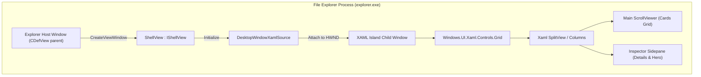
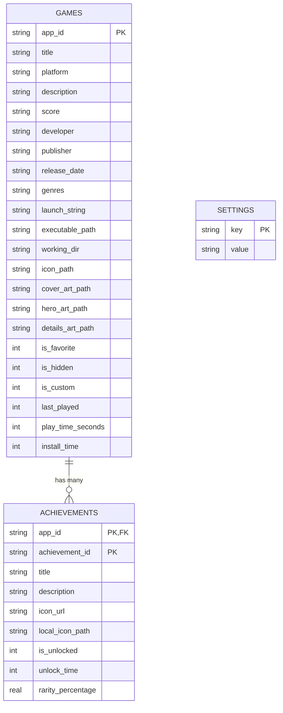
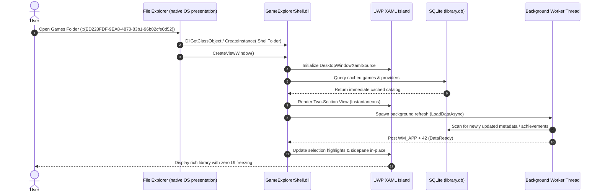

# Developer & Technical Reference

> Engineering specifications, architecture diagrams, build instructions, and internals for **Windows Game Explorer**.

---

## 📑 Table of Contents
1. [Codebase Organization](#1-codebase-organization)
2. [UWP XAML Islands Shell Architecture](#2-uwp-xaml-islands-shell-architecture)
3. [Core Engine Internals](#3-core-engine-internals)
4. [SQLite Database Schema](#4-sqlite-database-schema)
5. [Build Pipelines & Quality Gates](#5-build-pipelines--quality-gates)
6. [Unit Testing Architecture](#6-unit-testing-architecture)
7. [Sequence Diagrams](#7-sequence-diagrams)

---

## 1. Codebase Organization

The repository is organized into distinct, modular targets under CMake:

```text
projects/windows-game-explorer/
├── CMakeLists.txt                  <- Root build configuration (C++20, /W4 /WX)
├── game-explorer.bat               <- Single CLI dispatcher (build/test/lint/package/release/register/…)
├── scripts/
│   ├── _common.ps1                 <- Shared banner, colours and result helpers
│   ├── build.ps1                   <- CMake configure + /W4 /WX build
│   ├── test.ps1                    <- C++ unit test runner
│   ├── lint.ps1                    <- PSScriptAnalyzer zero-warning gate
│   ├── package.ps1                 <- Portable ZIPs + NSIS setup installer
│   ├── register.ps1                <- Shell extension registration (elevated)
│   ├── unregister.ps1              <- Shell extension removal (elevated)
│   ├── sign.ps1                    <- Authenticode signing
│   ├── generate-installer-art.ps1  <- Installer sidebar/header bitmaps
│   └── setup-signing-secrets.ps1   <- GitHub signing secrets
├── include/GameExplorerCore/       <- Public C++ API headers
│   ├── AchievementEngine.h         <- Multi-source achievement provider interface
│   ├── DarkMode.h                  <- DWM & Win32 dark mode interop
│   ├── Database.h                  <- SQLite3 library wrapper
│   ├── ImageValidator.h            <- Aspect-ratio and non-destructive image fitting
│   ├── Localization.h              <- Multi-language UI string tables
│   ├── Models.h                    <- GameItem, AchievementItem, ProviderItem data structs
│   ├── OwnedGames.h                <- Owned-game sources, filters, sorting and paging
│   ├── PlatformLauncher.h          <- Protocol & emulator execution dispatch
│   ├── Settings.h                  <- Configuration manager
│   ├── Storage.h                   <- OneDrive sync & filesystem paths
│   ├── StorefrontScanner.h         <- Installed storefront and ROM discovery engine
│   ├── StudioPages.h               <- Page factories for the unified Studio window
│   ├── SynopsisFormatter.h         <- GitHub Flavored Markdown synopsis rendering
│   ├── ThemeControls.h             <- Shared Fluent control theming
│   ├── ThemeFieldScroll.h          <- Fluent multi-line field scrolling
│   ├── ThemeScroll.h               <- Fluent scrollbar geometry
│   └── Types.h                     <- Enumerations and common aliases
├── src/
│   ├── core/                       <- GameExplorerCore.lib implementation
│   │   ├── AchievementEngine.cpp
│   │   ├── Database.cpp
│   │   ├── ImageValidator.cpp
│   │   ├── Localization.cpp
│   │   ├── OwnedGames.cpp          <- Storefront/API owned-game scanners, merge, filter, page
│   │   ├── PlatformLauncher.cpp
│   │   ├── Settings.cpp
│   │   ├── Storage.cpp
│   │   ├── StorefrontScanner.cpp
│   │   ├── SynopsisFormatter.cpp
│   │   └── Theme*.cpp              <- ThemeControls, ThemeFieldScroll, ThemeScroll
│   ├── shell/                      <- GameExplorerShell.dll (in-process IShellView)
│   │   ├── CategoryProvider.cpp    <- ICategoryProvider / ICategorizer sections
│   │   ├── ClassFactory.cpp        <- COM class factory
│   │   ├── DllMain.cpp             <- DLL entry point
│   │   ├── GameItemUI.cpp          <- Game cards, artwork and Inspector sidepane
│   │   ├── Registration.cpp        <- DllRegisterServer / DllUnregisterServer COM keys
│   │   ├── ShellFolder.cpp         <- IShellFolder / IPersistFolder2 / IPersistIDList
│   │   ├── ShellView.cpp           <- IShellView / UWP XAML Island implementation
│   │   └── Resource.rc             <- Icons, manifest and version resource
│   ├── view/                       <- LibraryViewHost (shell view hosting glue)
│   ├── studio/                     <- GameExplorerStudio.exe frame and pages
│   │   ├── StudioMain.cpp          <- Single window, Fluent tab strip, command-line parsing
│   │   └── CataloguePage.cpp       <- Game Catalogue page (owned-game list, filters, install delegation)
│   ├── manager/                    <- Library Manager page source (compiled into GameExplorerStudio.exe)
│   ├── config/                     <- Configuration page source (compiled into GameExplorerStudio.exe)
│   └── service/                    <- GameExplorerService.exe (preloading, directory monitoring, warm cache)
├── tests/                          <- Automated C++ unit test suite
│   ├── TestAchievementEngine.cpp
│   ├── TestDatabase.cpp
│   ├── TestImageValidator.cpp
│   ├── TestOwnedGames.cpp
│   ├── TestPlatformLauncher.cpp
│   ├── TestSettings.cpp
│   ├── TestStorefrontScanner.cpp
│   ├── TestSynopsisFormatter.cpp
│   └── TestThemeScroll.cpp
├── installer/                      <- NSIS installer script & packaging assets
│   └── windows-game-explorer.nsi
└── third_party/                    <- Bundled dependencies (SQLite amalgamation)
    └── sqlite/
        ├── sqlite3.c
        └── sqlite3.h
```

---

## 2. UWP XAML Islands Shell Architecture

Windows Game Explorer uses the UWP XAML hosting API (`DesktopWindowXamlSource`) from its native C++ shell view inside the active File Explorer process (`explorer.exe`). Windows 10 version 1903 (build 18362) is the documented API floor; the OS retains control of Explorer's chrome and presentation.



### DirectComposition & Lifecycle Management
Embedding UWP XAML Islands into an unmanaged Win32 host requires strict lifecycle and composition handling:
- **Zero Win32 `SetParent` on XAML Island Windows**: Direct calls to `SetParent` on XAML Island windows break the DirectComposition visual tree and throw uncatchable `0xc000027b` stowed exceptions. Instead, the HWND host relationship is established strictly via `IDesktopWindowXamlSourceNative::AttachToWindow`.
- **Thread Singleton `WindowsXamlManager`**: `WindowsXamlManager::InitializeForCurrentThread()` must be held alive as a thread singleton. Tearing it down prematurely causes heap corruption on subsequent tab openings.
- **Clean Content Disconnection**: When switching tabs or closing a folder view, `DesktopWindowXamlSource::Content(nullptr)` is called first, followed by `.Close()`, ensuring all composition surfaces release cleanly without memory leaks or crashes.
- **In-Place Card Selection**: Selecting a game card executes `SelectGame(index)`, which mutates element visual styling in-place and updates the sidepane without destroying or re-instantiating the XAML tree or resetting the vertical scroll position.

---

## 3. Core Engine Internals

### Background service scheduling and messages
`GameExplorerService` routes startup, `RESCAN`/`PRELOAD`, and directory-change requests through
`src/service/PreloadWorker.h`: one joined scan thread, with at most one pending follow-up scan.
Stopping rejects new requests, discards pending work, and waits for an active scan to return.
Directory monitoring waits on all registered change notifications and the stop event together,
instead of blocking sequentially inside `ReadDirectoryChangesW`.

Service command/response tokens, diagnostic text, and display strings live in
`src/service/ServiceMessages.h`. IPC tokens are protocol constants and must not be localized;
user-facing GUI text continues to use `GameExplorerCore/Localization.h`.
Preload failures are reported through debug output. The current IPC publishes counts only;
the scanned vectors are not a shared shell/Studio cache. Named-pipe I/O remains synchronous,
and active scans are joined rather than forcibly interrupted.

### `StorefrontScanner`
The scanner locates and parses local manifests without launching storefront clients or making network requests:
- **Steam**: Traverses `libraryfolders.vdf` across all drives, parsing `appmanifest_<appId>.acf` files. Extracts titles, installation folders, and authentic vertical box art from `%STEAM%\appcache\librarycache\<appId>_library_600x900.jpg`.
- **Ubisoft Connect**: Parses the local binary cache file `%LOCALAPPDATA%\Ubisoft Game Launcher\cache\configuration\configurations`, resolving game titles, `.ico` desktop icons, vertical cover thumbnails, and widescreen hero banners directly from the official Ubisoft asset CDN.
- **Text & Mojibake Sanitization (`SanitizeGameText`)**: All titles, descriptions, and metadata strings pass through a multi-pass sanitizer that decodes HTML entities (`&quot;`, `&amp;`), eliminates CP1252/UTF-8 double-encoding mojibake (`’`, `Sarada�s Rise` ➔ `Sarada's Rise`), and strips corrupted dangling emoji bytes.

### `AchievementEngine`
A modular architecture with runtime dispatch across platforms:
- **`IAchievementProvider`**: Base virtual interface defining `GetAchievementsForGame(appId)` and `GetProgress(appId)`.
- **`SteamAchievementProvider`**: Connects to the Steamworks Web API (`GetPlayerAchievements` and `GetSchemaForGame`), calculating completion percentages and caching badge art in `%USERPROFILE%\Game Explorer\cache\badges\`.
- **`RetroAchievementsProvider`**: Connects to RetroAchievements Web API endpoints for emulated systems.
- **`GOGGalaxyAchievementProvider`**: Connects to Galaxy metadata endpoints.

### `ImageValidator`
Ensures artwork assets match target aspect ratios without destructive stretching:
- **Aspect Ratio Validation**: Validates whether an image fits the SteamGridDB standard 2:3 vertical cover ratio (`0.58 <= ratio <= 0.82`), 3.1:1 widescreen hero ratio (`1.30 <= ratio <= 3.60`), or 1:1 square ratio.
- **Non-Destructive Preservation**: Source artwork is never forcibly cropped or overwritten. Original storefront assets are stored in `detailsArtPath` so native resolutions remain accessible in the Details pane.

---

## 4. SQLite Database Schema

The library database is located at `%USERPROFILE%\Game Explorer\library.db`.



---

## 5. Build Pipelines & Quality Gates

### Compiler Requirements
- **Operating System**: Windows 10 or Windows 11 development environment
- **Compiler**: Visual Studio 2022 (MSVC v143+) or Visual Studio 2026 Build Tools
- **C++ Standard**: C++20 (`/std:c++20 /permissive-`)
- **Windows SDK**: Version 10.0.22000.0 or later (current build environment targets 10.0.26100.0; this is not the runtime minimum)
- **CMake**: Version 3.25 or later

### MSVC Zero-Warning Quality Gate
Every target in Windows Game Explorer is compiled under strict quality gate flags:
```cmake
if(MSVC)
    add_compile_options(/W4 /WX /permissive- /utf-8)
endif()
```
- `/W4`: Highest standard compiler warning level.
- `/WX`: Treats all warnings as fatal errors.
- `/permissive-`: Strict conformance mode.
- `/utf-8`: Enforces UTF-8 source and execution character sets.

### Automation Scripts

| Script | Purpose | Execution |
|---|---|---|
| `game-explorer.bat build [Release]` | One-click incremental C++ build (`/W4 /WX`) | `.\game-explorer.bat build Release` |
| `game-explorer.bat test [Release]` | C++ unit test execution | `.\game-explorer.bat test Release` |
| `game-explorer.bat lint` | PSScriptAnalyzer zero-warning gate for `scripts\*.ps1` | `.\game-explorer.bat lint` |
| `game-explorer.bat package [Release]` | Portable ZIPs and NSIS installer packaging | `.\game-explorer.bat package Release` |
| `game-explorer.bat release` | Release build, unit tests, and packaging in one pass | `.\game-explorer.bat release` |
| `game-explorer.bat register` / `unregister` | Elevated shell extension registration/removal (portable package) | `.\game-explorer.bat register` |
| `game-explorer.bat sign` / `art` / `setup-signing` | Authenticode signing, installer artwork, GitHub secrets | `.\game-explorer.bat help` |

`game-explorer.bat` is the only batch file: it never opens a second window and runs every
PowerShell runbook from `scripts\` in the current console, so registration commands need an
already-elevated terminal.

### Game Explorer Studio Command-Line Switches

`GameExplorerStudio.exe` hosts the Library Manager, Game Catalogue, and Configuration pages in one window; the shell extension passes the switch that selects the page it needs:

| Switch | Behavior |
|---|---|
| `--tab=manager` \| `--tab=catalogue` \| `--tab=config` | Opens the Studio on the named page. Aliases: `--manager`, `--catalogue`, `--config`. |
| `--game=<appId>` | Opens the Library Manager pre-selected on the given game (implies `--tab=manager`). |
| `--register` | Registers the shell namespace extension by invoking `regsvr32` and broadcasting `SHCNE_ASSOCCHANGED`; self-elevates with a UAC prompt. |
| `--unregister` | Unregisters the shell namespace extension; self-elevates with a UAC prompt. |
| `--reset-cache` | Purges and rebuilds the artwork cache via `StorefrontScanner::ResetArtworkCache()`. |

---

## 6. Unit Testing Architecture

The test suite is built on a custom lightweight C++ test framework that requires zero external runtime dependencies (`tests/CMakeLists.txt` ➔ `GameExplorerTests.exe`).

### Running the Test Suite
Execute the full suite through the dispatcher (or the underlying script):
```powershell
.\game-explorer.bat test Release
# equivalent: pwsh -NoProfile -File scripts/test.ps1 -Configuration Release
```

### Coverage (87 Dedicated Unit Tests)

**Database (5)**
1. `DatabaseInitializationAndSchema` — table creation, indexes, and automated schema migrations.
2. `DatabaseUpsertAndQueryGame` — CRUD operations for `GameItem` records.
3. `DatabaseKeyValueSettingsPersistence` — dynamic settings storage.
4. `DatabaseAchievementUpsertAndProgress` — composite-key achievement batch upserts and unlock percentages.
5. `DatabaseDeleteGameByAppId` — single-title deletion cascading to achievements and metadata.

**Storefront discovery, smart scan heuristics, metadata and text (18)**
6. `ScannerMountedDrivesDiscovery` — multi-drive mounting and candidate search path resolution.
7. `ScannerBlacklistExecutableFilter` — exclusions for launcher helpers (`agent.exe`, `battlenet.exe`, etc.).
8. `ScannerCommonGameInstallationPaths` — path heuristics for standard gaming directories.
9. `ScannerKnownGameEngineDetection` — signature verification for Unity, Unreal, Godot, GameMaker, RPG Maker, Ren'Py, Source.
10. `PerGameMetadataSerializationAndPriority` — JSON serialization and override precedence.
11. `LaunchMethodMetadataRoundTrip` — launch-method overrides survive metadata serialization.
12. `CustomLocalGameLifecycle` — adding, querying, and removing custom standalone games.
13. `ScannerScanAllPrunesObsoleteGames` — pruning uninstalled games while preserving favorites.
14. `ScannerCleanRomTitleAndEmulatedScan` — title cleaning and leading-article inversion.
15. `ScannerUbisoftDetectionAndArtwork` — Ubisoft configuration-cache parsing and CDN URL generation.
16. `StorageOneDriveDirectoryCreationAndSync` — OneDrive `backups/`, `metadata/`, `art/` creation.
17. `TextSanitizationAndEntityDecoding` — HTML entities, CP1252 mojibake fixes, and emoji cleanup.
18. `ItchArtworkProtectionAndStrictTitleMatching` — itch.io artwork preservation and strict title matching.
19. `ArtworkSourcingPolicyForStoreVersusLocalGames` — store-artwork exclusivity policy.
20. `ScannerUniversalInstalledGameDetection` — provider-agnostic local install discovery.
21. `ScannerBenchmarkPerformanceSpeed` — sub-millisecond execution benchmark across game libraries.
22. `ScannerSmartScanSessionGateAndPerformance` — scan-session debouncing and cached metadata reuse.
23. `ScannerPrunesNonGameMetadataOnLoad` — automatic purge of non-game metadata entries.

**Owned-games catalogue (21)**
24. `OwnedGames_TokenMatchIsWholeTokenCaseInsensitive` — whole-token, case-insensitive search matching.
25. `OwnedGames_SearchMatchesTitleCaseInsensitive` — title search casing.
26. `OwnedGames_SortTitleDropsLeadingArticles` — article-insensitive title sorting.
27. `OwnedGames_FilterCombinesEveryActiveField` — compound multi-field filter queries.
28. `OwnedGames_SortUsesSelectedKeyThenTitle` — multi-column tie-breaker sorting.
29. `OwnedGames_PagingSlicesAndClamps` — windowed page slicing and bound clamping.
30. `OwnedGames_MarkInstalledFollowsLibrary` — cross-referencing local installed state against owned titles.
31. `OwnedGames_SteamJsonParsesGamesAndSkipsEmptyName` — robust Steam Store API response parsing.
32. `OwnedGames_SteamJsonHandlesEmptyLibraryAndGarbage` — malformed payload resilience.
33. `OwnedGames_NormalizeTitleKeyStripsPunctuationAndLeadingArticles` — canonical title key normalization.
34. `OwnedGames_PlatformListsAreParsedFromStorefrontJson` — multi-platform OS availability extraction.
35. `OwnedGames_PcGateNeedsWindowsEvidence` — Windows PC platform verification gate.
36. `OwnedGames_GogOsCompatibilityNeedsWindows` — GOG OS compatibility gating.
37. `OwnedGames_SteamStoreBrowseMarksOnlyNonWindowsApps` — Steam browse platform marking.
38. `OwnedGames_WindowsGateDropsOnlyNonWindowsSources` — per-source Windows gate.
39. `OwnedGames_MatchesStoreChecksBothPrimaryAndAllSources` — primary and merged source matching.
40. `OwnedGames_ExtractBaseTitleStripsCommonEditionSuffixes` — edition suffixes split from titles.
41. `OwnedGames_NormalizeTitleKeyCollapsesCrossEditionDuplicates` — cross-edition deduplication.
42. `OwnedGames_UbisoftConfigurationCacheResolvesTitles` — Ubisoft cache title resolution.
43. `OwnedGames_UbisoftOwnershipIdsAreLowercasedAndDeduped` — Ubisoft ownership ID normalization.
44. `OwnedGames_LegendaryAssetsMapToEpicOwnedGames` — legendary asset mapping to Epic rows.

**Achievements, settings, theme controls and platform launching (6)**
45. `PlatformEnumToStringAndBack` — enum conversion round-trips.
46. `PlatformLauncherSteamPathQuery` — registry discovery for platform launchers.
47. `PlatformLauncherEmulatorDiscovery` — automatic emulator discovery.
48. `SettingsDefaultsAndLayoutModes` — configuration defaults and theme detection.
49. `ThemeControls_CheckAndRadioToggleStateRetention` — themed check/radio state retention.
50. `AchievementEngineProviderDispatchAndCaching` — provider dispatch and local badge caching.

**Artwork validation, synopsis formatting and scrolling (18)**
51. `ImageValidatorSlotDimensionsAndAspectRatios` — aspect-ratio boundaries for every slot.
52. `ImageValidatorAssetPreservationAndNonDestructiveValidation` — originals never overwritten or cropped.
53. `SynopsisFormatterPlainTextPassThrough` — plain synopses render unchanged.
54. `SynopsisFormatterHeadingsAndBullets` — headings and bullets become rich text.
55. `SynopsisFormatterInlineEmphasis` — bold/italic/underline runs and line breaks.
56. `SynopsisFormatterPreservesUnderscoreWordsAndEscapes` — snake_case words survive emphasis parsing.
57. `SynopsisFormatterStripsMarkup` — residual markup stripped from output.
58. `SynopsisFormatterPreservesLineBreaks` — explicit line breaks survive formatting.
59. `SynopsisFormatterNumberedQuotesAndRules` — numbered lists, quotes and horizontal rules.
60. `SynopsisFormatterCodeAndLinks` — inline code and links.
61. `SynopsisFormatterTablesAndAutolinks` — tables and autolinks.
62. `SynopsisFormatterKeepsImageMarkupLiteral` — image markup stays literal.
63. `ThemeScroll_HiddenWhenContentFits` — scroll rail hides when content fits.
64. `ThemeScroll_ThumbTracksContentRatio` — thumb length tracks content ratio.
65. `ThemeScroll_ThumbNeverCollapses` — thumb keeps a usable minimum length.
66. `ThemeScroll_ScrollPositionClamped` — offsets stay inside the content range.
67. `ThemeScroll_DragMapsPointerToOffset` — pointer drag maps to content offsets.
68. `ThemeScroll_DragWithoutOverflowIsNoOp` — dragging is inert without overflow.

**Preload worker and background service execution (6)**
69. `PreloadWorker_RejectsMissingCallbacks` — validation of valid dispatch function pointers.
70. `PreloadWorker_IdleStopRejectsRequests` — graceful worker teardown and rejection of stale queries.
71. `PreloadWorker_CoalescesBurstAndSerializesScans` — debounce bursts into serialized scans.
72. `PreloadWorker_ReportsErrorsAndAcceptsSubsequentWork` — worker thread recovery after exceptions.
73. `PreloadWorker_DestructionJoinsActiveScan` — deterministic join on destructor.
74. `PreloadWorker_StopWaitsForActiveScanAndDiscardsPendingWork` — clean queue flushing.

**Shell loader & process injection boundaries (7)**
75. `ExplorerLoader_RequiresExactExplorerImage` — verification of explorer.exe binary path.
76. `ExplorerLoader_RejectsOtherUsersSessionsAndArchitectures` — cross-session process isolation.
77. `ExplorerLoader_RejectsMissingIdentityAndSelf` — process handle validation.
78. `ExplorerLoader_ReadsCurrentProcessIdentityAndRejectsItAsTarget` — self-target rejection.
79. `ExplorerLoader_LoadsModuleIntoIsolatedHostOnlyOnce` — idempotent DLL injection.
80. `ExplorerLoader_ReportsMissingModuleAndCanRecover` — missing DLL reporting and graceful fallback.
81. `ExplorerLoader_CancellationPreventsLoading` — asynchronous cancellation token enforcement.

**Updates and localization (6)**
82. `UpdateChecker_SemVerComparison` — SemVer comparison parsing (e.g. `v2.6.0` vs `v2.5.0`).
83. `UpdateChecker_ParseReleaseJsonWithValidAsset` — GitHub API release JSON parsing and asset matching.
84. `UpdateChecker_ParseReleaseJsonWhenUpToDate` — release checker no-op when on current release.
85. `UpdateChecker_ParseReleaseJsonMalformed` — malformed API response handling.
86. `LocalizationEngine_StringTableLoading` — Win32 string resource table lookup.
87. `LocalizationEngine_IndirectStringFormat` — SHLoadIndirectString formatting.

---

## 7. Sequence Diagrams

### Shell Navigation & Asynchronous Loading


