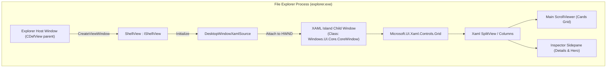
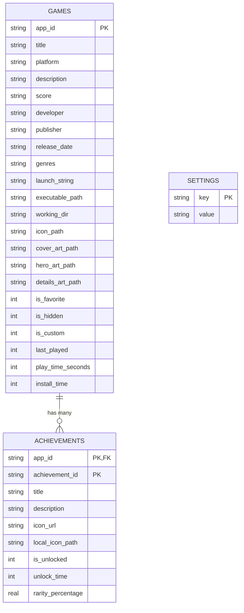
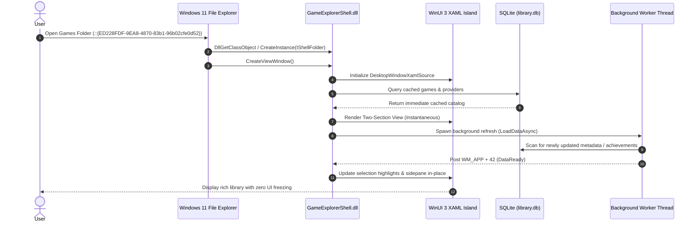

# Developer & Technical Reference

> Engineering specifications, architecture diagrams, build instructions, and internals for **Windows Game Explorer**.

---

## 📑 Table of Contents
1. [Codebase Organization](#1-codebase-organization)
2. [WinUI 3 XAML Islands Shell Architecture](#2-winui-3-xaml-islands-shell-architecture)
3. [Core Engine Internals](#3-core-engine-internals)
4. [SQLite Database Schema](#4-sqlite-database-schema)
5. [Build Pipelines & Quality Gates](#5-build-pipelines--quality-gates)
6. [Unit Testing Architecture](#6-unit-testing-architecture)
7. [Sequence Diagrams](#7-sequence-diagrams)

---

## 1. Codebase Organization

The repository is organized into distinct, modular targets under CMake:

```text
projects/windows-game-explorer/
├── CMakeLists.txt                  <- Root build configuration (C++20, /W4 /WX)
├── build.bat                       <- Fast developer build runner
├── release.bat                     <- Full release runner (build + test + NSIS package)
├── register.bat                    <- Portable shell extension registrar
├── unregister.bat                  <- Portable shell extension unregistrar
├── include/
│   └── GameExplorerCore/           <- Public C++ API headers
│       ├── AchievementEngine.h     <- Multi-source achievement provider interface
│       ├── DarkMode.h              <- DWM & Win32 dark mode interop
│       ├── Database.h              <- SQLite3 library wrapper
│       ├── ImageValidator.h        <- Aspect-ratio and non-destructive image fitting
│       ├── Localization.h          <- Multi-language UI string tables
│       ├── Models.h                <- GameItem, AchievementItem, ProviderItem data structs
│       ├── PlatformLauncher.h      <- Protocol & emulator execution dispatch
│       ├── Settings.h              <- Configuration manager
│       ├── Storage.h               <- OneDrive sync & filesystem paths
│       ├── StorefrontScanner.h     <- Storefront and ROM discovery engine
│       └── Types.h                 <- Enumerations and common aliases
├── src/
│   ├── core/                       <- GameExplorerCore.lib implementation
│   │   ├── AchievementEngine.cpp
│   │   ├── Database.cpp
│   │   ├── ImageValidator.cpp
│   │   ├── Localization.cpp
│   │   ├── PlatformLauncher.cpp
│   │   ├── Settings.cpp
│   │   ├── Storage.cpp
│   │   └── StorefrontScanner.cpp
│   ├── shell/                      <- GameExplorerShell.dll (In-process IShellView)
│   │   ├── Registration.cpp        <- DllRegisterServer / DllUnregisterServer COM keys
│   │   ├── ShellFolder.cpp         <- IShellFolder / IPersistFolder2 / IPersistIDList
│   │   ├── ShellView.cpp           <- IShellView / WinUI 3 XAML Island implementation
│   │   └── ShellView.h
│   ├── studio/                     <- GameExplorerStudio.exe (Studio frame & tab strip, Catalogue page)
│   │   ├── StudioMain.cpp          <- Single window, Fluent tab strip, command-line parsing
│   │   └── CataloguePage.cpp       <- Game Catalogue page (placeholder)
│   ├── manager/                    <- Library Manager page source (compiled into GameExplorerStudio.exe)
│   │   └── ManagerMain.cpp
│   └── config/                     <- Configuration page source (compiled into GameExplorerStudio.exe)
│       └── ConfigMain.cpp
├── tests/                          <- Automated C++ unit test suite
│   ├── CMakeLists.txt
│   ├── TestAchievementEngine.cpp
│   ├── TestDatabase.cpp
│   ├── TestImageValidator.cpp
│   ├── TestPlatformLauncher.cpp
│   └── TestStorefrontScanner.cpp
├── installer/                      <- NSIS installer script & packaging assets
│   └── windows-game-explorer.nsi
└── third_party/                    <- Bundled dependencies (SQLite amalgamation)
    └── sqlite/
        ├── sqlite3.c
        └── sqlite3.h
```

---

## 2. WinUI 3 XAML Islands Shell Architecture

Windows Game Explorer delivers a native Windows 11 WinUI 3 interface directly inside the classic File Explorer process (`explorer.exe`) using **XAML Islands** (`DesktopWindowXamlSource`).



### DirectComposition & Lifecycle Management
Embedding modern WinUI 3 XAML Islands into an unmanaged Win32 host requires strict lifecycle and composition handling:
- **Zero Win32 `SetParent` on XAML Island Windows**: Direct calls to `SetParent` on XAML Island windows break the DirectComposition visual tree and throw uncatchable `0xc000027b` stowed exceptions. Instead, the HWND host relationship is established strictly via `IDesktopWindowXamlSourceNative::AttachToWindow`.
- **Thread Singleton `WindowsXamlManager`**: `WindowsXamlManager::InitializeForCurrentThread()` must be held alive as a thread singleton. Tearing it down prematurely causes heap corruption on subsequent tab openings.
- **Clean Content Disconnection**: When switching tabs or closing a folder view, `DesktopWindowXamlSource::Content(nullptr)` is called first, followed by `.Close()`, ensuring all composition surfaces release cleanly without memory leaks or crashes.
- **In-Place Card Selection**: Selecting a game card executes `SelectGame(index)`, which mutates element visual styling in-place and updates the sidepane without destroying or re-instantiating the XAML tree or resetting the vertical scroll position.

---

## 3. Core Engine Internals

### `StorefrontScanner`
The scanner locates and parses local manifests without launching storefront clients or making network requests:
- **Steam**: Traverses `libraryfolders.vdf` across all drives, parsing `appmanifest_<appId>.acf` files. Extracts titles, installation folders, and authentic vertical box art from `%STEAM%\appcache\librarycache\<appId>_library_600x900.jpg`.
- **Ubisoft Connect**: Parses the local binary cache file `%LOCALAPPDATA%\Ubisoft Game Launcher\cache\configuration\configurations`, resolving game titles, `.ico` desktop icons, vertical cover thumbnails, and widescreen hero banners directly from the official Ubisoft asset CDN.
- **Text & Mojibake Sanitization (`SanitizeGameText`)**: All titles, descriptions, and metadata strings pass through a multi-pass sanitizer that decodes HTML entities (`&quot;`, `&amp;`), eliminates CP1252/UTF-8 double-encoding mojibake (`’`, `Sarada�s Rise` ➔ `Sarada's Rise`), and strips corrupted dangling emoji bytes.

### `AchievementEngine`
A modular architecture with runtime dispatch across platforms:
- **`IAchievementProvider`**: Base virtual interface defining `GetAchievementsForGame(appId)` and `GetProgress(appId)`.
- **`SteamAchievementProvider`**: Connects to the Steamworks Web API (`GetPlayerAchievements` and `GetSchemaForGame`), calculating completion percentages and caching badge art in `%USERPROFILE%\Game Explorer\cache\badges\`.
- **`RetroAchievementsProvider`**: Connects to RetroAchievements Web API endpoints for emulated systems.
- **`GOGGalaxyAchievementProvider`**: Connects to Galaxy metadata endpoints.

### `ImageValidator`
Ensures artwork assets match target aspect ratios without destructive stretching:
- **Aspect Ratio Validation**: Validates whether an image fits the SteamGridDB standard 2:3 vertical cover ratio (`0.58 <= ratio <= 0.82`), 3.1:1 widescreen hero ratio (`1.30 <= ratio <= 3.60`), or 1:1 square ratio.
- **Non-Destructive Preservation**: Source artwork is never forcibly cropped or overwritten. Original storefront assets are stored in `detailsArtPath` so native resolutions remain accessible in the Details pane.

---

## 4. SQLite Database Schema

The library database is located at `%USERPROFILE%\Game Explorer\library.db`.



---

## 5. Build Pipelines & Quality Gates

### Compiler Requirements
- **Operating System**: Windows 11 (Version 22H2 or later recommended, Build 22000+)
- **Compiler**: Visual Studio 2022 (MSVC v143+) or Visual Studio 2026 Build Tools
- **C++ Standard**: C++20 (`/std:c++20 /permissive-`)
- **Windows SDK**: Version 10.0.22000.0 or later (Targeting 10.0.26100.0)
- **CMake**: Version 3.25 or later

### MSVC Zero-Warning Quality Gate
Every target in Windows Game Explorer is compiled under strict quality gate flags:
```cmake
if(MSVC)
    add_compile_options(/W4 /WX /permissive- /utf-8)
endif()
```
- `/W4`: Highest standard compiler warning level.
- `/WX`: Treats all warnings as fatal errors.
- `/permissive-`: Strict conformance mode.
- `/utf-8`: Enforces UTF-8 source and execution character sets.

### Automation Scripts

| Script | Purpose | Execution |
|---|---|---|
| `build.bat` | One-click incremental C++ build | `.\build.bat` |
| `release.bat` | Release build, unit test execution, and NSIS installer packaging | `.\release.bat` |
| `register.bat` | Self-elevating shell extension registration (portable package) | `.\register.bat` |
| `unregister.bat`| Self-elevating shell extension removal (portable package) | `.\unregister.bat` |

### Game Explorer Studio Command-Line Switches

`GameExplorerStudio.exe` hosts the Library Manager, Game Catalogue, and Configuration pages in one window; the shell extension passes the switch that selects the page it needs:

| Switch | Behavior |
|---|---|
| `--tab=manager` \| `--tab=catalogue` \| `--tab=config` | Opens the Studio on the named page. Aliases: `--manager`, `--catalogue`, `--config`. |
| `--game=<appId>` | Opens the Library Manager pre-selected on the given game (implies `--tab=manager`). |
| `--register` | Registers the shell namespace extension by invoking `regsvr32` and broadcasting `SHCNE_ASSOCCHANGED`; self-elevates with a UAC prompt. |
| `--unregister` | Unregisters the shell namespace extension; self-elevates with a UAC prompt. |
| `--reset-cache` | Purges and rebuilds the artwork cache via `StorefrontScanner::ResetArtworkCache()`. |

---

## 6. Unit Testing Architecture

The test suite is built on a custom lightweight C++ test framework that requires zero external runtime dependencies (`tests/CMakeLists.txt` ➔ `GameExplorerTests.exe`).

### Running the Test Suite
Execute tests using PowerShell:
```powershell
pwsh -NoProfile -File scripts/test.ps1 -Configuration Release
```

### Coverage (34 Dedicated Unit Tests)
1. **`DatabaseInitializationAndSchema`**: Verifies table creation, indexes, and automated schema migrations.
2. **`DatabaseUpsertAndQueryGame`**: Verifies CRUD operations for `GameItem` records.
3. **`DatabaseKeyValueSettingsPersistence`**: Verifies dynamic settings storage.
4. **`DatabaseAchievementUpsertAndProgress`**: Verifies composite primary key achievement batch upserts and unlock percentages.
5. **`ScannerMountedDrivesDiscovery`**: Validates multi-drive mounting and path resolution.
6. **`ScannerBlacklistExecutableFilter`**: Verifies exclusions for launcher helpers (`agent.exe`, `battlenet.exe`, etc.).
7. **`PerGameMetadataSerializationAndPriority`**: Validates JSON serialization and override precedence.
8. **`CustomLocalGameLifecycle`**: Tests adding, querying, and removing custom standalone games.
9. **`ScannerScanAllPrunesObsoleteGames`**: Verifies automatic pruning of uninstalled games while preserving favorite states.
10. **`ScannerCleanRomTitleAndEmulatedScan`**: Tests title cleaning and leading article inversion (`Legend of Zelda, The` ➔ `The Legend of Zelda`).
11. **`ScannerUbisoftDetectionAndArtwork`**: Tests Ubisoft configuration cache parsing and CDN URL generation.
12. **`StorageOneDriveDirectoryCreationAndSync`**: Tests OneDrive sync folder creation (`backups/`, `metadata/`, `art/`).
13. **`TextSanitizationAndEntityDecoding`**: Verifies HTML entity decoding, CP1252 mojibake fixes, and emoji cleanup.
14. **`PlatformEnumToStringAndBack`**: Tests enum conversion round-trips.
15. **`PlatformLauncherSteamPathQuery`**: Verifies registry discovery for platform launchers.
16. **`PlatformLauncherEmulatorDiscovery`**: Verifies automatic emulator discovery (Dolphin, PCSX2, Project64, etc.).
17. **`SettingsDefaultsAndLayoutModes`**: Validates initial configuration defaults and theme detection.
18. **`AchievementEngineProviderDispatchAndCaching`**: Verifies provider dispatch and local badge image caching.
19. **`ImageValidatorSlotDimensionsAndAspectRatios`**: Validates aspect ratio boundaries for Cover, Hero, Icon, and Details slots.
20. **`ImageValidatorAssetPreservationAndNonDestructiveValidation`**: Verifies that original assets are never destructively overwritten or cropped.
21. **`LaunchMethodMetadataRoundTrip`**: Verifies launch-method overrides (store client, secondary launcher, direct executable) survive metadata serialization.
22. **`ItchArtworkProtectionAndStrictTitleMatching`**: Verifies itch.io artwork URLs are preserved and title matching stays strict.
23. **`ArtworkSourcingPolicyForStoreVersusLocalGames`**: Verifies the store-artwork exclusivity policy (store art wins, no automatic provider gap-filling).
24. **`SynopsisFormatterPlainTextPassThrough`**: Verifies plain synopses render unchanged with correct wrapping.
25. **`SynopsisFormatterHeadingsAndBullets`**: Verifies heading and bullet markup becomes rich formatted text.
26. **`SynopsisFormatterInlineEmphasis`**: Verifies bold/italic/underline runs and line breaks.
27. **`SynopsisFormatterPreservesUnderscoreWordsAndEscapes`**: Verifies snake_case words survive emphasis parsing.
28. **`SynopsisFormatterStripsMarkup`**: Verifies residual markup is stripped from the output.
29. **`ThemeScroll_HiddenWhenContentFits`**: Verifies the Fluent scroll rail hides when content fits.
30. **`ThemeScroll_ThumbTracksContentRatio`**: Verifies thumb length tracks the visible-to-total content ratio.
31. **`ThemeScroll_ThumbNeverCollapses`**: Verifies the thumb keeps a usable minimum length.
32. **`ThemeScroll_ScrollPositionClamped`**: Verifies scroll offsets stay inside the content range.
33. **`ThemeScroll_DragMapsPointerToOffset`**: Verifies pointer drag maps to content offsets.
34. **`ThemeScroll_DragWithoutOverflowIsNoOp`**: Verifies dragging is inert when nothing overflows.

---

## 7. Sequence Diagrams

### Shell Navigation & Asynchronous Loading


