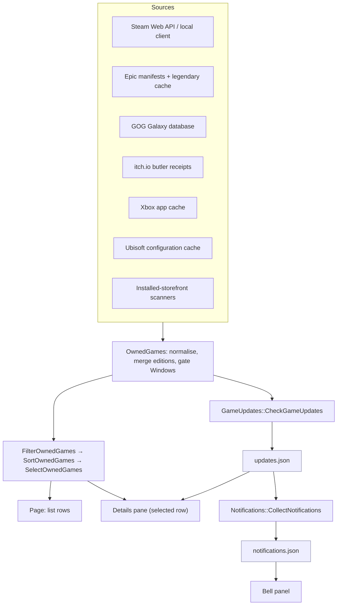
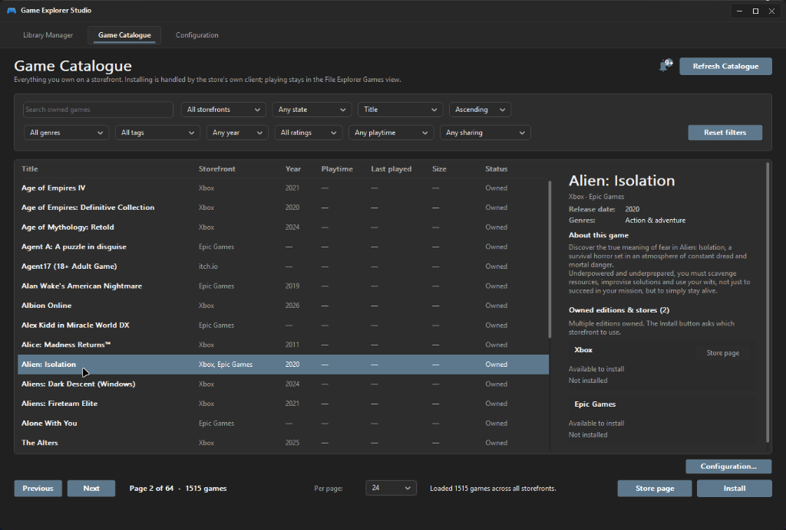

# Game Catalogue Internals

> How the owned-games catalogue is assembled, how update verdicts are produced, how the notification
> bell feed is built, and how the details pane and bell panel render it.

The catalogue is deliberately a **read-only inspector**: it browses, reports and delegates. It never
launches a game, never manages install folders, and never writes to a storefront.

---

## 1. Data flow



- **Assembly** (`OwnedGames.cpp`) is synchronous and offline apart from optional HTTP enrichment; it
  runs on the catalogue's background sync thread, never on the UI thread.
- **Filtering/sorting/paging** are pure functions, which is why they carry 21 dedicated tests.
- **Updates and alerts** are produced only by the service, and only read here.

---

## 2. Owned-game model

`OwnedGame` (`include/GameExplorerCore/OwnedGames.h`) is the merged row:

| Field group | Fields |
|---|---|
| Identity | `appId`, `title`, `sortTitle` |
| Stores | `storeKey`, `storeName`, `productId`, `sources[]` |
| Actions | `storePageUrl`, `installUri` |
| Metadata | `coverArtUrl`, `developer`, `publisher`, `releaseDate`, `releaseYear`, `genres`, `tags`, `rating`, `synopsis` |
| State | `installed`, `familyShared` |

`StorefrontSource` carries the per-edition facts the details pane shows:

| Field | Meaning |
|---|---|
| `storeKey` / `storeName` / `productId` | Which store, and its native id |
| `storePageUrl` | Product page to open |
| `installUri` | Official client protocol (`steam://install/<id>`, …) |
| `editionLabel` | Suffix split out of the title (`Deluxe Edition`, …) |
| `installed` | Installed on this machine |
| `installedBuildId` / `latestBuildId` | Build identities when the storefront exposes them |
| `windowsInstallable` | Result of the platform gate for this source |

### Merge rules

- **Windows-installable gate**: a source without Windows evidence is dropped, so a storefront-only
  console title never becomes a row.
- **Cross-store merge**: the same normalised title key collapses into one `OwnedGame`, with every
  storefront kept in `sources[]` and joined into the `storeName` label (`"Steam, Xbox"`).
- **Edition suffixes** are stripped from the canonical title into `editionLabel`, so *Deluxe Edition*
  variants do not create duplicate rows.
- **Sort titles** drop leading articles (`The Witcher 3` sorts under **W**), matching library sorting.
- **Search** is whole-token, case-insensitive, and punctuation-normalised, so `ff7` matches
  `Final Fantasy VII`-style shorthands only when the token genuinely matches.

### Filter/sort/page contract

`OwnedGamesFilter` fields: `search`, `storeKey`, `installed` (-1 any / 0 owned-not-installed / 1
installed), `genre`, `tag`, `releaseYear`, `rating`, `playtime` threshold, `familyShared` (-1/0/1).

`SelectOwnedGames` always clamps `pageIndex` into `[0, pageCount-1]` and returns
`OwnedGamesPage{ items, totalMatches, pageIndex, pageCount, pageSize }`, so the footer indicator
(`Page N of M · X games`) cannot disagree with the rows on screen.

---

## 3. Update checker (`GameUpdates`)

### States

| `GameUpdateState` | Token in JSON | UI text |
|---|---|---|
| `Unknown` | `unknown` | no verdict yet |
| `UpToDate` | `up_to_date` | **Up to date** |
| `UpdateAvailable` | `update_available` | **Update available** |
| `NotSupported` | `not_supported` | **Not supported** |
| `Failed` | `failed` | **Failed** |

The state machine is the contract: **a check that cannot answer is never mapped to `UpToDate`.** A
malformed Steam payload becomes `Failed`, a missing GOG latest build becomes `NotSupported`, and a
missing installed build id means no request at all.

### Steam

```text
GET https://api.steampowered.com/ISteamApps/UpToDateCheck/v1/?appid=<appId>&version=<installedBuildId>
```

- Installed build comes from `appmanifest_<appId>.acf` (`buildid`).
- `up_to_date: true` → `UpToDate`.
- `up_to_date: false` → `UpdateAvailable`, with `required_version` as `latestBuildId` and Steam's own
  `message` preserved verbatim for the pane.
- `success: false` or an unreadable payload → `Failed`.
- No API key, no account, no session cookie.

### GOG Galaxy

Installed `buildId` from `goggame-*.info`, compared with the build ids Galaxy records under
`ImportedLatestBuildIds`. Numeric comparison when both sides are numeric, textual fallback otherwise.
If Galaxy has never imported a latest build, the answer is `NotSupported` — not "up to date".

### Epic and Xbox

The installed version (`AppVersionString` from `.item`, package version for MSIX) is reported so the
pane can show *something*, but the verdict is `NotSupported`: neither storefront publishes a public
"newest build" endpoint.

### Report aggregation

`CheckGameUpdates(games)` walks every installed source and returns a `GameUpdateReport`:

```cpp
struct GameUpdateReport {
    std::wstring checkedAt;          // ISO-8601 UTC
    size_t installedSources;         // editions considered
    size_t checkedSources;           // editions the storefront could compare
    size_t updatesAvailable;         // editions behind
    std::vector<GameUpdateRecord> records;
};
```

`FindUpdateRecord(report, storeKey, productId)` is case-insensitive on the store key and is what the
details pane calls per edition card.

---

## 4. Cache file formats

Both files live in `%LOCALAPPDATA%\Game Explorer\` and are written by the service, read by the Studio.
Parsing is lenient: an empty, truncated or missing file means "no data", never an error dialog.

### `updates.json`

```json
{
  "version": 1,
  "checkedAt": "2026-10-28T09:41:07Z",
  "installedSources": 12,
  "checkedSources": 9,
  "updatesAvailable": 3,
  "records": [
    {"store": "steam", "product": "730", "state": "update_available",
     "installed": "11138802", "latest": "11138805", "message": "..."}
  ]
}
```

### `notifications.json`

```json
{
  "version": 1,
  "generatedAt": "2026-10-28T09:41:07Z",
  "items": [
    {"id": "gamerpower:12345", "kind": "free_game", "source": "GamerPower",
     "game": "", "title": "...", "body": "...", "url": "https://...", "published": 1761644467}
  ]
}
```

Kind tokens are stable because the file survives upgrades: `update`, `news`, `free_game`,
`promotion`. Display labels are separate (`Update available`, `Store news`, `Free game`,
`Deal & promotion`) so wording can change without invalidating a cache.

### `notifications-seen.json`

```json
{ "version": 1, "seen": ["gamerpower:12345", "steam:730:4412"] }
```

Read-state is a plain list of alert ids written by the Studio. Unknown ids are ignored on read.
Ids are appended when an alert is opened or **Mark all read** is used; the list is not pruned when
an alert disappears from the feed, so it grows slowly and stays valid across feed refreshes.

---

## 5. Notification feed (`Notifications`)

### Sources

| Producer | Parser | Mapping |
|---|---|---|
| `GameUpdates` report | `AppendUpdateNotifications` | `UpdateAvailable` → `update` |
| Steam announcements | `ParseSteamNewsItems` | per owned app, `steam_community_announcements` |
| GOG.com news | `ParseRssNewsItems` | RSS 2.0 → `news` |
| Xbox Wire | `ParseRssNewsItems` | RSS 2.0 → `news` |
| Epic Games Store blog | `ParseEpicBlogPosts` | JSON → `news` |
| GamerPower | `ParseGamerPowerGiveaways` | `Game` → `free_game`; `Loot`/`Beta` → `promotion` |

Additional rules:

- **Recency window** — news items older than 30 days are dropped; active giveaways are not
  age-filtered, because GamerPower stops returning them when they expire.
- **Per-source limits** — RSS and Epic parsers cap at 12 items each (`kMaxPerFeed`); Steam
  announcements request two items per app (`count=2`), keeping the panel readable.
- **Attribution** — GamerPower data requires an active link back to GamerPower.com; the panel footer
  renders it unconditionally (`Free game and deal data powered by GamerPower`).
- **Markup stripping** — Steam BBCode and RSS/HTML are reduced to plain text for `title`/`body`.

### Feed construction

`BuildNotificationFeed(items, ...)`:

1. Drops kinds disabled by `NotificationSettings`.
2. Deduplicates by `id` (stable per source: `gamerpower:<id>`, `steam:<appId>:<gid>`, …).
3. Sorts newest first; undated items sort last.
4. Stamps `generatedAt` with the pass time.

`NotificationSettingsFrom(AppSettings)` is the only bridge from user settings to feed behaviour, so
the eight `notify_*` keys cannot drift from the eight switches.

### Failure isolation

Each parser is written to **drop the individual item it cannot understand** rather than abort the
feed. Truncated JSON, missing fields, unknown kinds and hostile markup all produce a smaller feed,
never an exception path. `Notifications_ParsersTolerateTruncatedPayloads` enforces this.

---

## 6. UI implementation



### Details pane

The details pane is built inside `src/studio/CataloguePage.cpp` as a scrolling column:

- **Identity block** — canonical title, storefront label, developer, publisher, release date.
- **Play facts** — release year, rating, genres, tags, playtime, last played, install size, family
  sharing.
- **Synopsis** — the same sanitised text the Library Manager edits.
- **Owned editions** — one card per `StorefrontSource` with install state, installed build, update
  verdict and a single **Store page** button.
- **Scrolling** — wheel, scrollbar thumb drag and scroll-rail clicks, sharing one offset model.

The pane is only laid out when the page is wide enough (≥ ~1120 px); narrow windows keep the
full-width list and rely on the footer actions.

The pane deliberately has **no Play and no per-store Install button**: playing belongs to the shell
Games view, and installing is the single footer **Install** menu, which lists every owned edition.

### Bell button and panel

- `GameExplorerCatalogueBell` / `GameExplorerCatalogueBellPanel` are **custom child windows**, not a
  system popup — that keeps them inside the Studio's composition and DPI handling.
- Geometry: button 40 px, panel width 420 px, 8 px gap, header 48 px, footer 52 px, height clamped to
  240–560 px.
- **Badge** shows the unread count, capped at `9+`; the bell glyph is the accent colour when unread
  alerts exist, `textPrimary` while hovered or open, and `textSecondary` when idle.
- **Rows** show kind label, source, title, summary and a relative timestamp; clicking a row marks it
  read and opens `url` through the shell.
- **Scrolling** supports wheel, keyboard (`Up`/`Down`/`Page Up`/`Page Down`/`Home`/`End`), thumb drag
  and scroll-rail clicks.
- **Dismissal** happens on the bell, on a page-background click (`WM_LBUTTONDOWN` handled by
  `CataloguePageProc`), and on `Esc`. `WM_PARENTNOTIFY` alone is insufficient because it only reports
  child-window clicks.
- `WS_CLIPSIBLINGS` on the list, details pane and bell children prevents a sibling from painting over
  the open panel.

### Threading

- The catalogue list is populated by a worker (`BeginCatalogueSync`) and marshalled back to the UI
  thread; the page never blocks on the database.
- Service requests (`CHECK_UPDATES` + `GET_UPDATES_STATUS`) run on a bounded background wait; the
  button is disabled while a check is in flight.
- Feed and report reads are file parses — small, synchronous, and safe on the UI thread.

---

## 7. Extending the catalogue

Adding a source:

1. Produce `OwnedGame` rows with `sources[]` populated, including `storePageUrl` and `installUri`.
2. Populate `installedBuildId` if the storefront exposes one, otherwise leave it empty.
3. Ensure the Windows gate has evidence before emitting a source.
4. Add a parser test in `tests/TestOwnedGames.cpp`.

Adding an alert source:

1. Write a parser returning `NotificationItem` with a stable, namespaced `id`.
2. Map it to a `NotificationKind` and a settings switch (`NotificationSettings` + `AppSettings`).
3. Register the producer in `CollectNotifications`, keeping the 30-day/limit rules.
4. Add parser, dedupe and toggle tests in `tests/TestNotifications.cpp`.

Adding an update provider:

1. Implement the comparison in `CheckSourceUpdate` for the new `storeKey`.
2. Return `NotSupported` when no authoritative comparison exists — never guess.
3. Add a test proving both the success and the "cannot answer" path.

---

## See also

- [Background Service & IPC](./service-and-ipc.md) — where the pass runs.
- [Testing & Verification](./testing.md) — the tests that pin these rules.
- [Research: owned-games sources](./research/owned-games-sources.md) — per-store decisions.
- [User: Update Alerts & Notification Bell](../user/notifications.md) — the user-facing contract.
