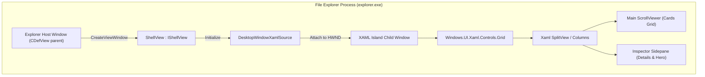
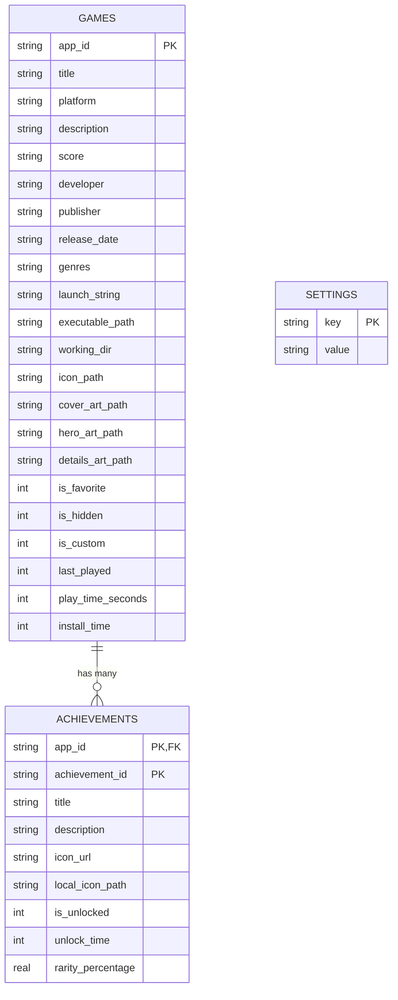
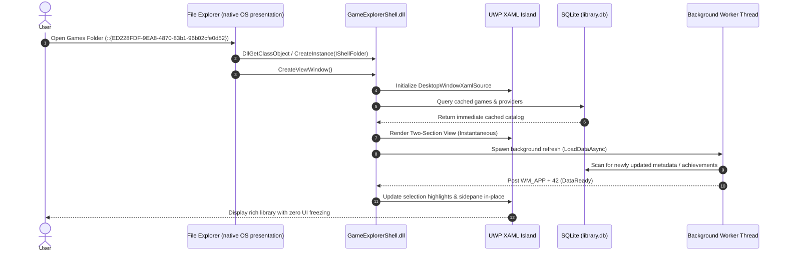

# Developer & Technical Reference

> Engineering specifications, architecture diagrams, build instructions, and internals for **Windows Game Explorer**.

---

## 📑 Table of Contents
1. [Codebase Organization](#1-codebase-organization)
2. [UWP XAML Islands Shell Architecture](#2-uwp-xaml-islands-shell-architecture)
3. [Core Engine Internals](#3-core-engine-internals)
4. [SQLite Database Schema](#4-sqlite-database-schema)
5. [Build Pipelines & Quality Gates](#5-build-pipelines--quality-gates)
6. [Testing & Verification](#6-testing--verification)
7. [Sequence Diagrams](#7-sequence-diagrams)

Related pages: [Background Service & IPC](./service-and-ipc.md) ·
[Game Catalogue Internals](./catalogue-internals.md) · [Testing & Verification](./testing.md) ·
[Developer documentation index](./README.md)

---

## 1. Codebase Organization

The repository is organized into distinct, modular targets under CMake:

```text
projects/windows-game-explorer/
├── CMakeLists.txt                  <- Root build configuration (C++20, /W4 /WX)
├── game-explorer.bat               <- Single CLI dispatcher (build/test/lint/package/release/register/…)
├── scripts/
│   ├── _common.ps1                 <- Shared banner, colours and result helpers
│   ├── build.ps1                   <- CMake configure + /W4 /WX build
│   ├── test.ps1                    <- C++ unit test runner
│   ├── lint.ps1                    <- PSScriptAnalyzer zero-warning gate
│   ├── package.ps1                 <- Portable ZIPs + NSIS setup installer
│   ├── register.ps1                <- Shell extension registration (elevated)
│   ├── unregister.ps1              <- Shell extension removal (elevated)
│   ├── sign.ps1                    <- Authenticode signing
│   ├── generate-installer-art.ps1  <- Installer sidebar/header bitmaps
│   └── setup-signing-secrets.ps1   <- GitHub signing secrets
├── include/GameExplorerCore/       <- Public C++ API headers
│   ├── AchievementEngine.h         <- Multi-source achievement provider interface
│   ├── DarkMode.h                  <- DWM & Win32 dark mode interop
│   ├── Database.h                  <- SQLite3 library wrapper
│   ├── GameUpdates.h               <- Per-game update verdicts (Steam UpToDateCheck, GOG local builds)
│   ├── ImageValidator.h            <- Aspect-ratio and non-destructive image fitting
│   ├── Localization.h              <- Multi-language UI string tables
│   ├── LocalizationEngine.h        <- Win32 string-resource lookup
│   ├── Models.h                    <- GameItem, AchievementItem, ProviderItem data structs
│   ├── Notifications.h             <- Notification feed model, GamerPower/storefront news parsers
│   ├── OwnedGames.h                <- Owned-game sources, filters, sorting and paging
│   ├── PlatformLauncher.h          <- Protocol & emulator execution dispatch
│   ├── ServiceClient.h             <- Named-pipe client for the background service
│   ├── ServiceProtocol.h           <- Pipe name, command and response tokens
│   ├── Settings.h                  <- Configuration manager
│   ├── Storage.h                   <- OneDrive sync & filesystem paths
│   ├── StorefrontScanner.h         <- Installed storefront and ROM discovery engine
│   ├── StudioPages.h               <- Page factories for the unified Studio window
│   ├── SynopsisFormatter.h         <- GitHub Flavored Markdown synopsis rendering
│   ├── ThemeControls.h             <- Shared Fluent control theming
│   ├── ThemeFieldScroll.h          <- Fluent multi-line field scrolling
│   ├── ThemeScroll.h               <- Fluent scrollbar geometry
│   ├── Types.h                     <- Enumerations and common aliases
│   └── UpdateChecker.h             <- Application (GitHub release) update checker
├── src/
│   ├── core/                       <- GameExplorerCore.lib implementation
│   │   ├── AchievementEngine.cpp
│   │   ├── Database.cpp
│   │   ├── GameUpdates.cpp         <- Steam/GOG build comparison, cached in updates.json
│   │   ├── ImageValidator.cpp
│   │   ├── Localization.cpp
│   │   ├── LocalizationEngine.cpp
│   │   ├── Notifications.cpp       <- Feed build, dedupe, seen state in notifications(-seen).json
│   │   ├── OwnedGames.cpp          <- Storefront/API owned-game scanners, merge, filter, page
│   │   ├── PlatformLauncher.cpp
│   │   ├── ServiceClient.cpp       <- Pipe client + bounded CHECK_UPDATES polling
│   │   ├── Settings.cpp
│   │   ├── Storage.cpp
│   │   ├── StorefrontScanner.cpp
│   │   ├── SynopsisFormatter.cpp
│   │   ├── Theme*.cpp              <- ThemeControls, ThemeFieldScroll, ThemeScroll
│   │   └── UpdateChecker.cpp       <- GitHub release check, SemVer comparison
│   ├── shell/                      <- GameExplorerShell.dll (in-process IShellView)
│   │   ├── CategoryProvider.cpp    <- ICategoryProvider / ICategorizer sections
│   │   ├── ClassFactory.cpp        <- COM class factory
│   │   ├── DllMain.cpp             <- DLL entry point
│   │   ├── GameItemUI.cpp          <- Game cards, artwork and Inspector sidepane
│   │   ├── Registration.cpp        <- DllRegisterServer / DllUnregisterServer COM keys
│   │   ├── ShellFolder.cpp         <- IShellFolder / IPersistFolder2 / IPersistIDList
│   │   ├── ShellView.cpp           <- IShellView / UWP XAML Island implementation
│   │   └── Resource.rc             <- Icons, manifest and version resource
│   ├── view/                       <- LibraryViewHost (shell view hosting glue)
│   ├── studio/                     <- GameExplorerStudio.exe frame and pages
│   │   ├── CataloguePage.cpp       <- Game Catalogue page (list, filters, details pane, bell, install delegation)
│   │   ├── CatalogueStrings.h      <- Catalogue + bell display strings
│   │   └── StudioMain.cpp          <- Single window, Fluent tab strip, command-line parsing
│   ├── manager/                    <- Library Manager page source (compiled into GameExplorerStudio.exe)
│   ├── config/                     <- Configuration page source (compiled into GameExplorerStudio.exe)
│   └── service/                    <- GameExplorerService.exe + GameExplorerWatcher.exe
│       ├── ServiceMain.cpp         <- Service entry, console-user impersonation, refresh workers
│       ├── ServiceMessages.h       <- Service diagnostic text and display strings
│       ├── PreloadWorker.h         <- Bounded, serialized scan worker
│       ├── WatcherMain.cpp         <- Explorer lifecycle watcher
│       ├── WatcherMessages.h       <- Watcher switches and CLI help
│       ├── ExplorerLoader.cpp/.h   <- Strict-identity module injection into explorer.exe
│       └── ModuleLoader.h          <- Loader primitives
├── tests/                          <- Automated C++ unit test suite
│   ├── TestAchievementEngine.cpp
│   ├── TestDatabase.cpp
│   ├── TestGameUpdates.cpp
│   ├── TestImageValidator.cpp
│   ├── TestNotifications.cpp
│   ├── TestOwnedGames.cpp
│   ├── TestPlatformLauncher.cpp
│   ├── TestSettings.cpp
│   ├── TestStorefrontScanner.cpp
│   ├── TestSynopsisFormatter.cpp
│   └── TestThemeScroll.cpp
├── docs/                           <- Documentation hub
│   ├── README.md                   <- Hub
│   ├── overview.md                 <- Project overview & architecture
│   ├── user/                       <- User documentation (installation, guides, FAQ)
│   └── developer/                  <- Engineering reference + dated research records
├── installer/                      <- NSIS installer script & packaging assets
│   └── windows-game-explorer.nsi
└── third_party/                    <- Bundled dependencies (SQLite amalgamation)
    └── sqlite/
        ├── sqlite3.c
        └── sqlite3.h
```

---

## 2. UWP XAML Islands Shell Architecture

Windows Game Explorer uses the UWP XAML hosting API (`DesktopWindowXamlSource`) from its native C++ shell view inside the active File Explorer process (`explorer.exe`). While Windows 10 version 1903 (build 18362) was the documented XAML Islands API floor, Windows Game Explorer targets Windows 11 (Build 22000+) exclusively as its supported operating system environment.



### DirectComposition & Lifecycle Management
Embedding UWP XAML Islands into an unmanaged Win32 host requires strict lifecycle and composition handling:
- **Zero Win32 `SetParent` on XAML Island Windows**: Direct calls to `SetParent` on XAML Island windows break the DirectComposition visual tree and throw uncatchable `0xc000027b` stowed exceptions. Instead, the HWND host relationship is established strictly via `IDesktopWindowXamlSourceNative::AttachToWindow`.
- **Thread Singleton `WindowsXamlManager`**: `WindowsXamlManager::InitializeForCurrentThread()` must be held alive as a thread singleton. Tearing it down prematurely causes heap corruption on subsequent tab openings.
- **Clean Content Disconnection**: When switching tabs or closing a folder view, `DesktopWindowXamlSource::Content(nullptr)` is called first, followed by `.Close()`, ensuring all composition surfaces release cleanly without memory leaks or crashes.
- **In-Place Card Selection**: Selecting a game card executes `SelectGame(index)`, which mutates element visual styling in-place and updates the sidepane without destroying or re-instantiating the XAML tree or resetting the vertical scroll position.

---

## 3. Core Engine Internals

### Background service scheduling and messages
`GameExplorerService` routes startup, `RESCAN`/`PRELOAD`, and directory-change requests through
`src/service/PreloadWorker.h`: one joined scan thread, with at most one pending follow-up scan.
Stopping rejects new requests, discards pending work, and waits for an active scan to return.
Directory monitoring waits on all registered change notifications and the stop event together,
instead of blocking sequentially inside `ReadDirectoryChangesW`.

Service command/response tokens, diagnostic text, and display strings live in
`src/service/ServiceMessages.h`; the wire tokens themselves live in
`include/GameExplorerCore/ServiceProtocol.h` so the service and `ServiceClient` cannot drift apart.
IPC tokens are protocol constants and must not be localized; user-facing GUI text continues to use
`GameExplorerCore/Localization.h`.
Preload failures are reported through debug output. The IPC publishes counts and refresh status
only; the scanned vectors, update report, and notification feed are handed over as files in the
user's environment rather than as a shared in-memory cache. Named-pipe I/O remains synchronous, and
active scans are joined rather than forcibly interrupted.

### `StorefrontScanner`
The scanner locates and parses local manifests without launching storefront clients or making network requests:
- **Steam**: Traverses `libraryfolders.vdf` across all drives, parsing `appmanifest_<appId>.acf` files. Extracts titles, installation folders, and authentic vertical box art from `%STEAM%\appcache\librarycache\<appId>_library_600x900.jpg`.
- **Ubisoft Connect**: Parses the local binary cache file `%LOCALAPPDATA%\Ubisoft Game Launcher\cache\configuration\configurations`, resolving game titles, `.ico` desktop icons, vertical cover thumbnails, and widescreen hero banners directly from the official Ubisoft asset CDN.
- **Text & Mojibake Sanitization (`SanitizeGameText`)**: All titles, descriptions, and metadata strings pass through a multi-pass sanitizer that decodes HTML entities (`&quot;`, `&amp;`), eliminates CP1252/UTF-8 double-encoding mojibake (`’`, `Sarada�s Rise` ➔ `Sarada's Rise`), and strips corrupted dangling emoji bytes.

### `AchievementEngine`
A modular architecture with runtime dispatch across platforms:
- **`IAchievementProvider`**: Base virtual interface defining `GetAchievementsForGame(appId)` and `GetProgress(appId)`.
- **`SteamAchievementProvider`**: Connects to the Steamworks Web API (`GetPlayerAchievements` and `GetSchemaForGame`), calculating completion percentages and caching badge art in `%USERPROFILE%\Game Explorer\cache\badges\`.
- **`RetroAchievementsProvider`**: Connects to RetroAchievements Web API endpoints for emulated systems.
- **`GOGGalaxyAchievementProvider`**: Connects to Galaxy metadata endpoints.

### `ImageValidator`
Ensures artwork assets match target aspect ratios without destructive stretching:
- **Aspect Ratio Validation**: Validates whether an image fits the SteamGridDB standard 2:3 vertical cover ratio (`0.45 <= ratio <= 1.15`), 3.1:1 / 16:9 widescreen hero ratio (`1.20 <= ratio <= 4.50`), or 1:1 square icon ratio (`0.75 <= ratio <= 1.33`).
- **Non-Destructive Preservation**: Source artwork is never forcibly cropped or overwritten. Artificial cropping is disabled to avoid damaging resolution or cropping off key visual elements; authentic native aspect assets are retrieved from metadata providers or supplied via custom metadata.

### `GameUpdates`
Compares an installed edition against the build its storefront publishes, using the exact
storefront the game was installed through:
- **Steam (`ISteamApps/UpToDateCheck`)**: keyless official endpoint,
  `GET https://api.steampowered.com/ISteamApps/UpToDateCheck/v1/?appid=<appId>&version=<installedBuildId>`.
  The installed build comes from `appmanifest_<appId>.acf` (`buildid`); the response's
  `up_to_date` / `required_version` produce the verdict. A malformed payload is a failure, never
  an implicit "up to date".
- **GOG Galaxy**: installed `buildId` from the game's `goggame-*.info` file against Galaxy's
  `ImportedLatestBuildIds` cache. Without an imported latest build the verdict is `NotSupported`
  instead of a guess.
- **Epic / Xbox**: the installed version from the `.item` manifest or package is reported, but the
  verdict stays `NotSupported` because neither storefront publishes a public comparison endpoint.
- Uninstalled editions and editions without an installed build id never touch the network.

Results are cached in `%USERPROFILE%\Game Explorer\updates.json` as a `GameUpdateReport`, so the
Catalogue details pane renders the last known verdict instantly and never blocks on HTTP.

### `Notifications`
Builds the catalogue bell feed from four independent sources and writes it to
`%USERPROFILE%\Game Explorer\notifications.json`:
- **Game update alerts** from `GameUpdates` (only when a newer build exists).
- **Storefront news** restricted to the last 30 days: Steam per-app
  `ISteamNews/GetNewsForApp/v2` with `feeds=steam_community_announcements`, the GOG.com news RSS
  feed, the Epic Games Store blog JSON (`store-content.ak.epicgames.com/.../content/blog`), and the
  Xbox Wire RSS feed. Each storefront has its own switch.
- **Free games** and **deals/promotions** from GamerPower
  (`https://www.gamerpower.com/api/giveaways?platform=pc`) — `type=game` maps to a free game,
  `loot`/`beta` map to a promotion. The GamerPower feed requires an active attribution hyperlink
  back to GamerPower.com, which the panel always renders.

`GameExplorer::CollectNotifications` applies the per-source toggles from `AppSettings`, dedupes by
stable ids (for example `gamerpower:<id>`), and sorts newest first. Read state is a plain id list in
`notifications-seen.json`; ids that disappear from the feed are pruned so the file cannot grow
without bound. Parsers tolerate truncated or partial network payloads by dropping the individual
item rather than failing the whole pass.

### Update/notification IPC and impersonation
`include/GameExplorerCore/ServiceProtocol.h` holds the pipe name
(`\\.\pipe\GameExplorerService`) and every command/response token, shared by the service and
`ServiceClient`. The refresh-specific tokens are `CHECK_UPDATES` → `CHECK_STARTED` and
`GET_UPDATES_STATUS` → `RUNNING`/`IDLE`.

The service runs as `LocalSystem`, while every path involved (`%USERPROFILE%\Game Explorer`,
storefront client caches, the settings database) is user-scoped. `RunAsConsoleUser` resolves the
active console session with `WTSGetActiveConsoleSessionId`, duplicates that user's token through
`WTSQueryUserToken`, and runs the work under `ImpersonateLoggedOnUser`. When nobody is signed in the
pass is skipped rather than written into the service account's profile. `WTSRegisterSessionNotification`
re-runs the pass when the interactive session logs on or unlocks, and `PreloadWorker` keeps at most
one pending refresh so a burst of requests cannot pile up scans.

---

## 4. SQLite Database Schema

The library database is located at `%USERPROFILE%\Game Explorer\library.db`.



---

## 5. Build Pipelines & Quality Gates

### Compiler Requirements
- **Operating System**: Windows 11 (Build 22000+) development environment
- **Compiler**: Visual Studio 2022 (MSVC v143+) or Visual Studio 2026 Build Tools
- **C++ Standard**: C++20 (`/std:c++20 /permissive-`)
- **Windows SDK**: Version 10.0.22000.0 or later (current build environment targets 10.0.26100.0; this is not the runtime minimum)
- **CMake**: Version 3.25 or later

### MSVC Zero-Warning Quality Gate
Every target in Windows Game Explorer is compiled under strict quality gate flags:
```cmake
if(MSVC)
    add_compile_options(/W4 /WX /permissive- /utf-8)
endif()
```
- `/W4`: Highest standard compiler warning level.
- `/WX`: Treats all warnings as fatal errors.
- `/permissive-`: Strict conformance mode.
- `/utf-8`: Enforces UTF-8 source and execution character sets.

### Automation Scripts

| Script | Purpose | Execution |
|---|---|---|
| `game-explorer.bat build [Release]` | One-click incremental C++ build (`/W4 /WX`) | `.\game-explorer.bat build Release` |
| `game-explorer.bat test [Release]` | C++ unit test execution | `.\game-explorer.bat test Release` |
| `game-explorer.bat lint` | PSScriptAnalyzer zero-warning gate for `scripts\*.ps1` | `.\game-explorer.bat lint` |
| `game-explorer.bat package [Release]` | Portable ZIPs and NSIS installer packaging | `.\game-explorer.bat package Release` |
| `game-explorer.bat release` | Release build, unit tests, and packaging in one pass | `.\game-explorer.bat release` |
| `game-explorer.bat register` / `unregister` | Elevated shell extension registration/removal (portable package) | `.\game-explorer.bat register` |
| `game-explorer.bat sign` / `art` / `setup-signing` | Authenticode signing, installer artwork, GitHub secrets | `.\game-explorer.bat help` |

`game-explorer.bat` is the only batch file: it never opens a second window and runs every
PowerShell runbook from `scripts\` in the current console, so registration commands need an
already-elevated terminal.

### Game Explorer Studio Command-Line Switches

`GameExplorerStudio.exe` hosts the Library Manager, Game Catalogue, and Configuration pages in one window; the shell extension passes the switch that selects the page it needs:

| Switch | Behavior |
|---|---|
| `--tab=manager` \| `--tab=catalogue` \| `--tab=config` | Opens the Studio on the named page. Aliases: `--manager`, `--catalogue`, `--config`. |
| `--game=<appId>` | Opens the Library Manager pre-selected on the given game (implies `--tab=manager`). |
| `--register` | Registers the shell namespace extension by invoking `regsvr32` and broadcasting `SHCNE_ASSOCCHANGED`; self-elevates with a UAC prompt. |
| `--unregister` | Unregisters the shell namespace extension; self-elevates with a UAC prompt. |
| `--reset-cache` | Purges and rebuilds the artwork cache via `StorefrontScanner::ResetArtworkCache()`. |

---

## 6. Testing & Verification

The suite is a custom zero-dependency C++ harness that builds `GameExplorerTests.exe`
(`tests/CMakeLists.txt`). It covers the pure logic — storefront parsers, owned-games merge, filter,
page and sort, update comparison, notification parsers, synopsis formatting, scroll geometry,
preload worker and loader identity rules — plus SQLite and JSON round-trips.

```powershell
.\game-explorer.bat test Release     # 112 passed, 0 failed
```

The full 112-case inventory, the rules for adding a test, and the verification recipe (build, test,
lint, visual proof) are in **[Testing & Verification](./testing.md)**.

## 7. Sequence Diagrams

### Shell Navigation & Asynchronous Loading


