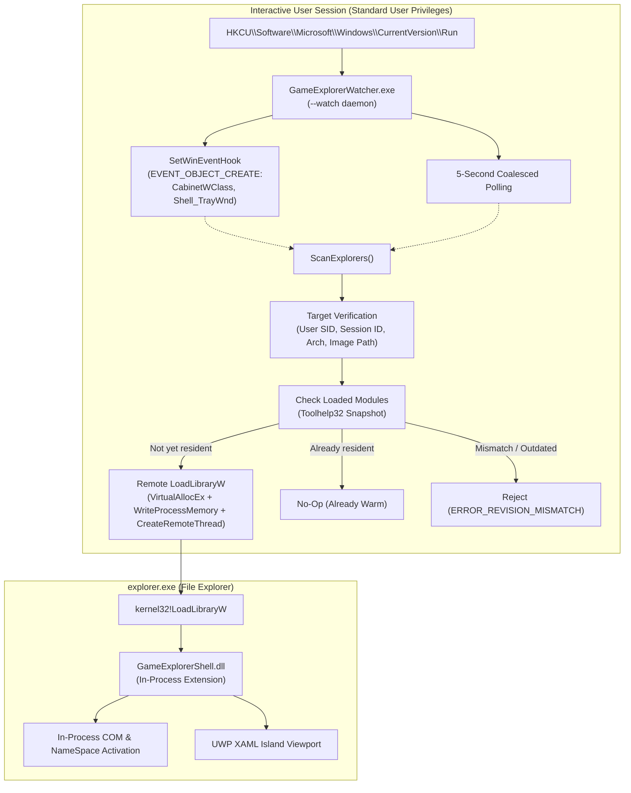

# Explorer Watcher & Lifecycle Loader Architecture

**Status:** Research & Architecture Specification, 2026-10-27  
**Scope:** Project-owned Explorer watcher/loader (`HOST-01`) for **Windows Game Explorer** (`projects/windows-game-explorer`).  
**Core Purpose:** Deliver a resilient, simple method to integrate the Games Library shell extension into File Explorer without relying on the flakiness of static `regsvr32` COM registry mutations, minimizing the risk of integration breakage from Windows updates.

---

## 1. Problem Statement & Motivation

Historically, Windows shell namespace extensions require registration via `regsvr32.exe` or installer scripts writing directly to the Windows Registry:
1. `HKLM\Software\Classes\CLSID\{...}\InProcServer32`
2. `HKLM\Software\Microsoft\Windows\CurrentVersion\Explorer\Desktop\NameSpace\{...}`
3. `HKLM\Software\Microsoft\Windows\CurrentVersion\Explorer\FolderDescriptions\{...}`

### The Flakiness of Static `regsvr32` & Windows Update Vulnerability

While standard, this conventional COM registration pattern suffers from critical real-world fragility:
- **Windows Update Resets:** Major Windows 10 and Windows 11 updates (feature updates, enablement packages, and monthly cumulative rollups) frequently refresh or rebuild the File Explorer shell key spaces (`Desktop\NameSpace`, `FolderDescriptions`, and default folder types). Third-party shell extensions registered through static keys often disappear from the Navigation Pane after an OS update, requiring manual re-registration or reinstall.
- **Elevation and UAC Friction:** Writing to `HKLM` requires full Administrator privileges and triggers UAC prompts during registration, complicating silent updates, portable use, and multi-user environments.
- **DLL Locking & Upgrade Collisions:** When `explorer.exe` activates `InProcServer32` via COM on-demand, it holds an open file handle to the DLL on disk. Upgrades or uninstalls fail with `ERROR_SHARING_VIOLATION` unless Explorer is forcibly killed.
- **Modern Tabbed Explorer Inconsistencies:** Modern Windows 11 File Explorer introduces XAML-based tabbed hosting (`CabinetWClass`), where static `FolderValueFlags` or `AllowChildAliasRegistration` flags frequently conflict with Microsoft's evolving internal tab manager.

---

## 2. The Watcher / Lifecycle Loader Paradigm

To resolve these issues, Windows Game Explorer adopts a **project-owned Explorer lifecycle watcher and loader** (`GameExplorerWatcher.exe`), delivering a reliable, native in-process integration with zero external runtime dependencies.

### Architectural Overview

---

## 3. Architecture & Integration Design Comparison

The lifecycle watcher operates by monitoring Explorer process instances strictly within the active user session and loading the shell extension DLL directly into `explorer.exe`.

| Dimension | Conventional Static Registry Model | Windows Game Explorer Lifecycle Watcher (`HOST-01`) |
| --- | --- | --- |
| **Scope** | Machine-wide static registry keys | **User-session scoped strictly** to target user's `explorer.exe` |
| **Privileges** | Administrator / HKLM required | **Standard Interactive User** (zero UAC prompts needed) |
| **Dependencies** | Static `regsvr32` keys | **Zero external dependencies** (pure native C++20 Win32) |
| **Durability** | Prone to removal by major Windows Updates | **Resilient across Windows updates** via automatic session activation |
| **Target Filter** | Static system registry | Strict validation: `imagePath == C:\Windows\explorer.exe`, same SID, same session, matching machine architecture |
| **Rollback / Cleanup** | Manual registry deletion | **Self-contained IPC**: `--stop`, `--disable` (clears Run key, signals stop event) |

---

## 4. Key Mechanisms of `GameExplorerWatcher`

### 4.1 Strict Session & Identity Isolation
The watcher must never attempt to inject into Explorer processes outside the active user's session or belonging to other users. In `src/service/ExplorerLoader.cpp`:
1. **User SID Validation:** Queries the process token (`OpenProcessToken` + `GetTokenInformation(TokenUser)`) to ensure the target's SID exactly matches the watcher's SID.
2. **Session ID Matching:** Validates `ProcessIdToSessionId(pid)` matches the active interactive session. Session 0 (system services) is explicitly rejected.
3. **Architecture Verification:** Uses `IsWow64Process2` to verify machine architecture (`IMAGE_FILE_MACHINE_AMD64` on x64), preventing cross-architecture injection faults.
4. **Image Path Normalization:** Compares `QueryFullProcessImageNameW` strictly against `GetWindowsDirectoryW() / "explorer.exe"`.

### 4.2 Deduplication & Anti-Tamper Guarantees
- Before allocating remote memory or spawning a remote thread, the watcher inspects the target's loaded modules using `CreateToolhelp32Snapshot(TH32CS_SNAPMODULE)`.
- If `GameExplorerShell.dll` is already loaded from the exact application path, injection is skipped (`alreadyLoaded = true`).
- If a DLL named `GameExplorerShell.dll` is already loaded from a *different* directory (e.g. an older install), the loader aborts with `ERROR_REVISION_MISMATCH` to prevent version collision.

### 4.3 Windows Update Immunity
- Because `GameExplorerWatcher.exe` runs from `HKCU\Software\Microsoft\Windows\CurrentVersion\Run`, it survives Windows feature updates that overwrite `HKLM` keys.
- When an OS update restarts or updates `explorer.exe`, the watcher detects the newly spawned Explorer instance and re-injects `GameExplorerShell.dll`.
- Per-user HKCU COM registration (`HKCU\Software\Classes\CLSID\...`) does not require elevation and is self-healed whenever the watcher is active.

### 4.4 Graceful Teardown and Rollback
The watcher implements clean CLI verbs (`WatcherMain.cpp`):
- `GameExplorerWatcher.exe --watch`: Headless background daemon.
- `GameExplorerWatcher.exe --enable`: Configures `HKCU\...\Run` entry and spawns the daemon.
- `GameExplorerWatcher.exe --disable`: Removes `HKCU\...\Run` entry, sets `WatcherDisabled = 1`, and signals the running watcher's stop event.
- `GameExplorerWatcher.exe --stop`: Signals the active watcher's named stop event (`Local\GameExplorerWatcher-<sid>-<session>-Stop`) and waits up to 15 seconds for clean exit.
- `GameExplorerWatcher.exe --inspect`: Scans and prints matching target Explorer PIDs and paths without mutating state.

---

## 5. COM Activation Preservation

A critical architectural insight of `HOST-01`: **injecting a DLL into `explorer.exe` pre-warms the module in memory, but does not bypass COM interface discovery.**
- File Explorer identifies virtual folders through CLSIDs (`CLSID_GameExplorer` `{1666B3DF-60A5-4EF3-8B80-962C82401CD1}`).
- When `GameExplorerShell.dll` is already resident in `explorer.exe`:
  - When the user navigates to `shell:Games` or clicks the pinned Games navigation entry, COM resolves `InProcServer32`.
  - Since the module is already loaded, `LoadLibraryW` inside COM is an instant pointer lookup (`GetModuleHandle`).
  - COM invokes `DllGetClassObject` directly to obtain `IClassFactory`, instantiating `ShellFolder` and `ShellView` with near-zero latency.
  - No cold disk I/O occurs inside Explorer's UI thread during navigation.

---

## 6. Verification & Quality Gates

The watcher architecture is covered by automated regression tests in `tests/TestExplorerLoader.cpp`:
- `ExplorerLoader_RequiresExactExplorerImage`: Rejects non-explorer binaries.
- `ExplorerLoader_RejectsOtherUsersSessionsAndArchitectures`: Rejects cross-user or cross-session processes.
- `ExplorerLoader_RejectsMissingIdentityAndSelf`: Rejects invalid handles and self-injection.
- `ExplorerLoader_ReadsCurrentProcessIdentityAndRejectsItAsTarget`: Verifies identity parsing.
- `ExplorerLoader_LoadsModuleIntoIsolatedHostOnlyOnce`: Spawns isolated test host (`GameExplorerLoaderHost.exe`) and verifies single injection of fixture DLL (`GameExplorerLoaderFixture.dll`).
- `ExplorerLoader_ReportsMissingModuleAndCanRecover`: Verifies error propagation on missing DLLs.
- `ExplorerLoader_CancellationPreventsLoading`: Verifies prompt abort when stop event is set.
