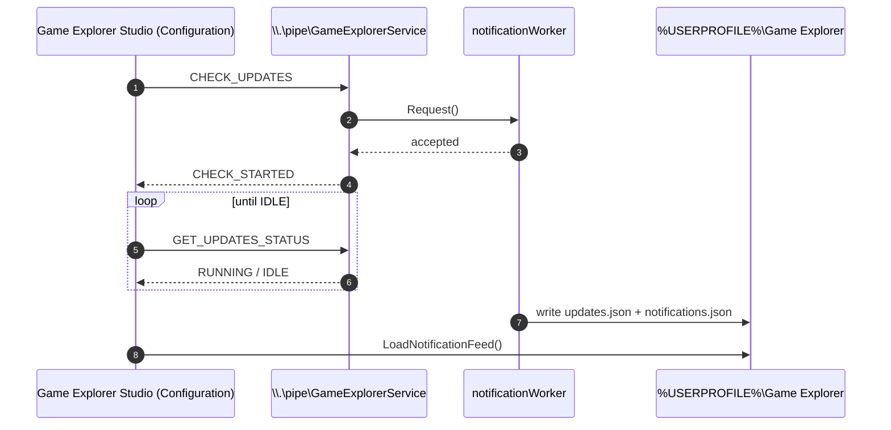

# Background Service & IPC

> `GameExplorerService` — what it does, how clients talk to it, how it reaches the signed-in user's
> profile from `LocalSystem`, and how it is installed and removed.

---

## 1. Why a service exists

The shell view and the Studio must show a populated library as fast as possible, and the catalogue
must show update verdicts and alerts without making network calls on the UI thread. The service
provides that:

- **Preload** — scans installed storefronts and the ROM tree once, warming the SQLite library so an
  Explorer window paints from a warm cache.
- **Directory monitoring** — watches storefront manifest folders and refreshes the cache when a game
  is installed, uninstalled or updated.
- **Once-per-session alert pass** — checks installed editions for newer builds, collects storefront
  news and GamerPower giveaways, and writes the caches the Studio reads.

It never renders UI, never owns a window, and never touches storefront files.

---

## 2. Process and lifecycle

| Property | Value |
|---|---|
| Service name | `GameExplorerService` |
| Display name | **Game Explorer Service** |
| Binary | `GameExplorerService.exe` |
| Account | `LocalSystem` |
| Start type | Automatic |
| Failure actions | Restart after 5 s, then 10 s, then 30 s (reset period 24 h) |
| Bootstrap task | Scheduled task `GameExplorerService`, run as `SYSTEM` at start with `--run` |
| Pipe | `\\.\pipe\GameExplorerService` |

The scheduled task exists because SCM start can be delayed by other boot services; the `--run`
switch starts the same worker loop directly when the process is not launched by the SCM.

### Command-line switches

| Switch | Behaviour |
|---|---|
| `--install` | Creates/updates the service, sets the failure actions, and registers the boot task. Requires elevation. |
| `--uninstall` | Deletes the boot task and stops/removes the service. |
| `--start` / `--stop` | Starts/stops the service through the SCM. |
| `--run` | Runs the worker loop standalone (used by the boot task). |
| *(no switch)* | Normal `StartServiceCtrlDispatcherW` entry point. |

### Worker threads

`ServiceMain` starts a named-pipe listener thread plus two `PreloadWorker` instances:

| Worker | Input | Effect |
|---|---|---|
| `preloadWorker` | `RESCAN`, `PRELOAD` | Runs the storefront scan and refreshes `g_preloadedInstalledCount` / `g_preloadedOwnedCount` |
| `notificationWorker` | `CHECK_UPDATES` | Runs the update + notification pass and rewrites `updates.json` / `notifications.json` |

`PreloadWorker` (see `src/service/PreloadWorker.h`) guarantees:

- **One joined scan thread** — a scan is never interrupted mid-flight.
- **At most one pending request** — a burst of commands coalesces into one follow-up pass.
- **Deterministic teardown** — stopping rejects new work, discards pending work, and joins the
  active scan before returning.
- **Error recovery** — a throwing scan reports through the error callback and leaves the worker ready
  for the next request.

`SERVICE_CONTROL_SESSIONCHANGE` re-runs the alert pass on `WTS_SESSION_LOGON` for the active
console session, so a machine that boots without a signed-in user still produces a feed later.

---

## 3. Running as the user, not as `LocalSystem`

The service runs as `LocalSystem`, but every path it touches is user-scoped:

- `%USERPROFILE%\Game Explorer\` (database, caches, feed files)
- storefront client caches (`%LOCALAPPDATA%`, `%PROGRAMDATA%` manifests)
- the SQLite database that holds settings

`RunAsConsoleUser` therefore does the work under the interactive user's token:

1. `WTSGetActiveConsoleSessionId` — the active console session.
2. `WTSQueryUserToken` — that session's user token.
3. `ImpersonateLoggedOnUser` — run the scan/refresh on that token.
4. `RevertToSelf` — restore the service identity.

Two subtleties matter when editing this code:

- **`SHGetKnownFolderPath` honours thread impersonation; `GetEnvironmentVariableW("USERPROFILE")`
  does not.** Resolve user paths through `Storage::GetUserRootPath()`, which uses the shell API, and
  never cache a profile path at service start.
- **When nobody is signed in, skip.** Writing into the service account's profile would create a
  second, invisible library. The service logs
  `no interactive console user is signed in; user-scoped work skipped` and waits for the next
  session notification.

---

## 4. The wire protocol

Tokens live in `include/GameExplorerCore/ServiceProtocol.h` so the service and `ServiceClient`
cannot drift apart. They are **protocol constants and are never localized** — user-facing text uses
`GameExplorerCore/Localization.h` instead.

| Command | Response | Meaning |
|---|---|---|
| `PING` | `PONG` | Liveness check |
| `STATUS` | `RUNNING` | The service is alive |
| `RESCAN` | `PRELOAD_STARTED` / `STOPPING` | Queue a storefront rescan |
| `PRELOAD` | `PRELOAD_STARTED` / `STOPPING` | Alias with the same bounded-worker semantics |
| `GET_COUNTS` | `INSTALLED=<n>;OWNED=<m>` | Cached scan counters |
| `CHECK_UPDATES` | `CHECK_STARTED` / `STOPPING` | Queue one update + alert pass |
| `GET_UPDATES_STATUS` | `RUNNING` / `IDLE` | Whether the alert pass is still running |
| *(anything else)* | `UNKNOWN` | Unrecognised command |

Transport details:

- Message-mode named pipe, duplex, **synchronous request/response** — one command per connection.
- `PIPE_REJECT_REMOTE_CLIENTS`; DACL grants Authenticated Users, Administrators, SYSTEM and
  LocalService, so the Studio needs no elevation.
- Responses are plain ASCII tokens; counts are appended as decimal numbers.
- The pipe loops forever, creates a fresh instance per client, and never blocks shutdown: the stop
  event breaks the accept loop.

### Client flow for a manual alert refresh



The client polls `GET_UPDATES_STATUS` with a bounded wait; it never blocks its UI thread on the
pipe, and it never assumes success — a `STOPPING` response means the service is shutting down.

---

## 5. What the pass writes

The service publishes results **as files**, not as shared memory:

| File | Written by | Read by |
|---|---|---|
| `updates.json` | `GameUpdates::RunUpdateCheck` → `SaveUpdateReport` | Catalogue details pane |
| `notifications.json` | `Notifications::CollectNotifications` → `SaveNotificationFeed` | Bell panel, Configuration status label |
| `notifications-seen.json` | Studio (read-state) | Bell panel on next open |

Keeping the handoff file-based means the Studio and Explorer never need a live service connection to
render what they already know; a stopped service degrades to "last known state" instead of an empty
UI.

`updates.json` and `notifications.json` shapes are documented in
[Catalogue Internals](./catalogue-internals.md#4-cache-file-formats).

---

## 6. Diagnostics

The service writes to **debug output** (capture with DebugView, or a debugger attached at start):

| Message | Meaning |
|---|---|
| `preload failed: <detail>` | A scan threw; the worker is still usable |
| `preload failed with an unknown exception` | Non-`std::exception` escape from a scan |
| `directory monitoring failed, Win32 error <n>` | A change-notification registration failed |
| `named-pipe operation failed, Win32 error <n>` | Pipe create/connect/read/write failure |
| `notification refresh reported: <detail>` | The alert pass returned an error |
| `no interactive console user is signed in; user-scoped work skipped` | Impersonation found no console session |

Manual checks:

```powershell
Get-Service GameExplorerService | Select-Object Status, StartType
sc qc GameExplorerService            # binary path, start type
schtasks /query /tn GameExplorerService
```

---

## 7. Install, upgrade and removal

- **Install** (`--install`) is what the NSIS setup calls after copying the binaries; it is also safe
  to call from a portable folder in an elevated terminal.
- **Upgrade** — the installer stops the service, replaces the binary, re-runs `--install` and
  `--start`. The service keeps no state of its own, so an upgrade never loses library data.
- **Removal** (`--uninstall`) deletes the boot task and stops/removes the service; the uninstaller
  additionally runs `sc delete` and task deletion as a belt-and-braces cleanup.
- **Development** — `game-explorer.bat build Release` stops the running service before linking,
  because the executable is locked while loaded.

---

## See also

- [Catalogue Internals](./catalogue-internals.md) — what the alert pass computes.
- [Developer Guide](./developer-guide.md#3-core-engine-internals) — scanner and engine internals.
- [User: Update Alerts & Notification Bell](../user/notifications.md) — the user-visible contract.
- [Research: startup background service](./research/startup-background-service.md) — why this
  architecture was chosen.
