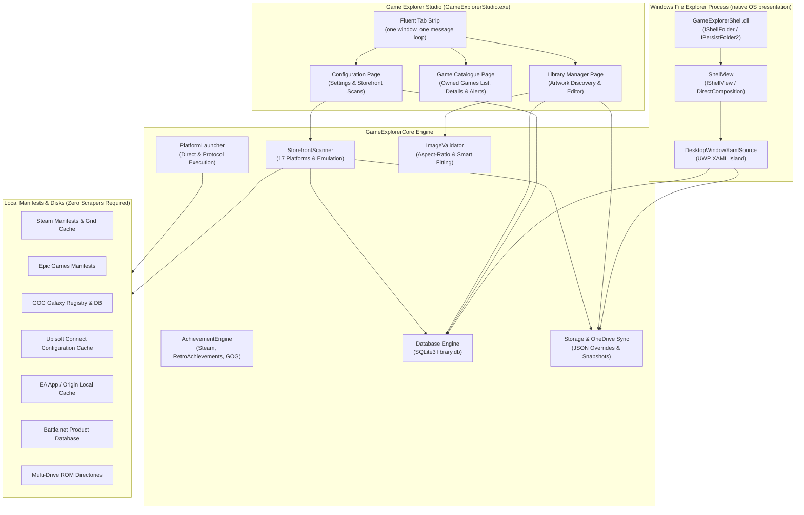
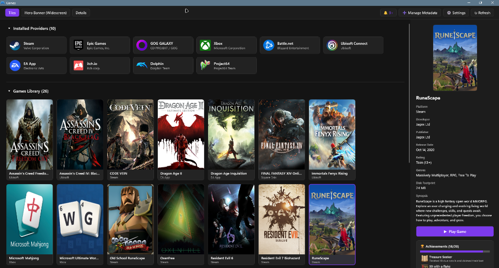

# Project Overview & Architecture

> An architectural and functional overview of **Windows Game Explorer**, a native C++20 shell extension that brings the classic Windows 7/Vista Game Explorer experience into Windows 10 and Windows 11 File Explorer.

---

## 🌟 Introduction & Motivation

During the Windows Vista and Windows 7 era, Windows shipped with a dedicated, system-level game library known as **Game Explorer**. It provided a unified place where all games—regardless of where they were purchased or installed—were cataloged with rich vertical box art, developer information, age ratings, and direct launch actions.

In modern Windows versions, Game Explorer was deprecated and eventually removed, leaving users dependent on fragmented, heavy, web-based launchers (Steam, Epic Games Launcher, Ubisoft Connect, EA App, Battle.net, GOG Galaxy) or cluttered desktop shortcuts.

**Windows Game Explorer** revives this classic capability natively inside Windows 11 File Explorer. Instead of creating another heavy electron application, it integrates directly into **File Explorer** as an in-process native C++ shell extension (`GameExplorerShell.dll`). It embeds **UWP XAML controls via XAML Islands** with fully responsive dynamic sizing across any window dimensions, and automatically collapses the left navigation pane and status bar in standalone `shell:games` windows.

---

## 🏛️ System Architecture

The project consists of three primary layers: the Shell Extension (`GameExplorerShell.dll`), the Core Engine (`GameExplorerCore.lib`), and Game Explorer Studio (`GameExplorerStudio.exe`), the single companion GUI that hosts the Library Manager, Game Catalogue, and Configuration pages.



---

## 🔑 Core Design Principles

### 1. Storefront-First Discovery (Zero Scrapers Required)
Unlike legacy tools that required manual Game Definition Files (GDF XML) or third-party web scrapers that break over time, Windows Game Explorer automatically indexes games directly from locally installed storefront manifests on disk. Steam `.acf` manifests, Epic `.item` files, GOG Galaxy registries, Ubisoft Connect binary configurations, and Battle.net manifests are parsed locally in milliseconds without requiring external API tokens or web scraping.

### 2. Native C++20 Performance & Minimal Footprint
The entire stack is authored in modern native C++20 (`/W4 /WX /permissive- /utf-8`) with direct Win32 and COM integrations. There are zero Chromium, Electron, or Node.js runtimes in the distribution. The complete release installer stays under 2 MB, and the shell extension loads instantly into File Explorer.

### 3. Non-Destructive Isolation Invariant
Windows Game Explorer strictly honors the **Native Isolation Invariant**:
- It **never** writes to, modifies, or overwrites external launcher files (such as Steam's `shortcuts.vdf`, `appmanifest.acf`, or Epic's manifest files).
- Game records, custom user overrides, and downloaded artwork persist exclusively within the user's private data folder:
  ```text
  %LOCALAPPDATA%\Game Explorer\
  ```
- Launches are always delegated through official client protocols (`steam://rungameid/<id>`, `com.epicgames.launcher://apps/<id>`, etc.) to ensure digital rights management (DRM), cloud saves, and social overlays remain intact.

### 4. Two-Section Game Library Experience
In File Explorer, the namespace is organized into two distinct, collapsible sections:
- **▾ Installed Providers**: A clean grid of installed client platforms (Steam, Epic Games, GOG, Ubisoft, EA App, Battle.net, etc.) with quick actions to launch storefronts or view status.
- **▾ Games Library**: The full unified library of games across all platforms, sortable and filterable.



---

## 🕹️ Supported Platforms & Storefronts

| Storefront / Origin | Detection Mechanism | Artwork & Metadata Extracted |
|---|---|---|
| **Steam** | Local `libraryfolders.vdf` and `appmanifest_*.acf` | 600x900 vertical box art, hero banner, icon, title, achievements |
| **Epic Games** | `%PROGRAMDATA%\Epic\EpicGamesLauncher\Data\Manifests\*.item` | Vertical box art, title, installation folder, launcher arguments |
| **GOG Galaxy** | Local SQLite `index.db` & registry keys | Vertical box art, developer, publisher, genres, icons, achievements |
| **Ubisoft Connect** | Local `%LOCALAPPDATA%\Ubisoft Game Launcher\cache\configuration\configurations` | Official CDN vertical box art, widescreen hero banner, `.ico` icon |
| **EA App / Origin** | `%PROGRAMDATA%\Electronic Arts\EA Desktop\installData\*.id` | Display name, executable, custom cover art |
| **Battle.net** | `product.db` protobuf parsing & uninstaller keys | Title, official launch protocols, desktop icons |
| **Itch.io** | `%APPDATA%\itch\broth\receipts\*.json` | Static covers (`still_cover_url`), title, executable paths |
| **Amazon Games** | `%LOCALAPPDATA%\Amazon Games\Data\Games\Sql\app.db` | High-res art, launch strings, game metadata |
| **Xbox / PC Game Pass** | Windows Package Manager (`AppModel\Repository\Packages`) & `.GamingRoot` | High-res package logos, display titles, URI launch endpoints |
| **Retro & Emulation ROMs** | Auto-detected across `<Drive>:\ROMs` and `<Drive>:\Games\ROMs` | Cleaned title names, Libretro Thumbnails CDN box art, direct emulator dispatch |
| **Standalone & Custom Executables** | User-added `.exe`, `.bat`, `.cmd`, `.lnk` files | Extracted PE version info, embedded icons, user custom artwork |

### Owned-Games Catalogue

Alongside the installed library, Game Explorer Studio hosts a **Game Catalogue** page that lists every game the user owns on a supported storefront, installed or not, in one filterable and paged list. Rows are assembled from the Steam Web API or local Steam client, Epic manifests and an optional read-only legendary cache, and read-only client databases for GOG Galaxy, itch.io, Xbox, and Ubisoft Connect, plus the installed-store scanners. A centralized Windows-installable gate removes titles that cannot run on Windows, and multi-store or multi-edition ownership collapses into a single row with the edition kept in the source label.


Selecting a row fills a details pane with the title's identity, play facts, synopsis and one card per owned edition. Each edition card reports its install state, its installed build when the storefront exposes one, an update verdict, and a single **Store page** action. The page remains a catalogue: it never launches a game and never manages install folders. The **Install** action hands the request to the storefront's own client, while playing stays in the File Explorer Games view.

A bell in the catalogue header collects the alerts the background service collects once per sign-in — newer builds for installed editions, recent news from the signed-in user's own storefront feeds, and GamerPower free games and deals (with the required attribution link). Update verdicts come from the storefront the game was installed through: Steam's official keyless `ISteamApps/UpToDateCheck` endpoint and GOG Galaxy's local latest-build cache are authoritative, while Epic and Xbox report the installed version and explicitly say the comparison is unsupported rather than guessing.

---

## 🎨 Multi-Viewport Presentation Modes

Windows Game Explorer supports three presentation modes aligned with industry standards:

1. **Cover Art Mode (2:3 Vertical Standard)**:
   - Form-fitting cards (`180x270` image port) displaying authentic vertical box art (SteamGridDB 600x900 reference standard).
   - Rendered using full-bleed proportional fitting with zero black bars or letterboxing.
2. **Hero Banner Mode (3.1:1 Widescreen Standard)**:
   - Form-fitting banner cards (`320x104` image port) matching modern Steam and SteamGridDB widescreen hero assets (`1920x620` and `960x310`).
   - Eliminates horizontal cropping while showcasing rich background wallpaper art.
3. **Details Mode (1:1 Square Icons)**:
   - High-density list with official 1:1 application icons, developer/publisher credits, release dates, and user ratings.

---

## 🏆 Universal Achievement Tracking

Windows Game Explorer features a modular multi-source achievement engine (`AchievementEngine`) that tracks progress and unlocks across platforms:
- **Steam**: Steamworks Web API integration with player unlock progress, achievement schemas, and public global percentage rates.
- **RetroAchievements**: Integrated Web API supporting emulated systems with completion tracking and badge caches.
- **GOG Galaxy**: Catalog achievement endpoint querying.
- **Shell Inspector**: Live trophy header card (`🏆 N / Total (XX%)`), WinUI `ProgressBar`, and up to 4 top unlock badges cached locally in `%LOCALAPPDATA%\Game Explorer\cache\badges\`.

---

## ☁️ Cloud Synchronization & Backups

For cross-machine backup and roaming profiles, the engine provides built-in bidirectional synchronization with Microsoft OneDrive:
- Automatically initializes `%OneDrive%\Windows Game Explorer` with `metadata/`, `backups/`, and `art/` directories.
- Backs up SQLite snapshots (`library.db`) and user metadata JSON overrides.
- Syncs seamlessly without locking active databases.
