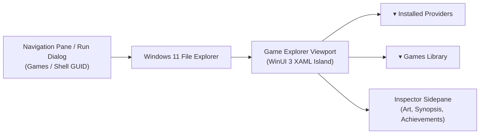

# Quick Start Guide

> Get up and running with **Windows Game Explorer** in under two minutes.

---

## 📥 Installation

Windows Game Explorer is distributed in two official formats: an automated installer and a portable standalone archive.

### Option A: Standard Setup Installer (Recommended)
1. Download the latest installer: `windows-game-explorer-v2.5.0-setup.exe` from the [GitHub Releases](https://github.com/HELIX-Origin/windows-game-explorer/releases).
2. Run the installer.
3. The setup automatically:
   - Installs the shell extension (`GameExplorerShell.dll`) and Game Explorer Studio (`GameExplorerStudio.exe`) to `%LOCALAPPDATA%\Programs\Windows Game Explorer\`.
   - Registers the COM shell extension in the Windows Registry (`HKEY_CURRENT_USER\Software\Classes\CLSID\...`).
   - Pins **Games** directly under File Explorer's navigation pane tree (alongside native Windows 11 *Home* and *Gallery*).

### Option B: Portable ZIP Package
1. Download `windows-game-explorer-v2.5.0-win64.zip`.
2. Extract the archive to any permanent folder (e.g. `C:\Tools\Windows Game Explorer`).
3. Open an elevated terminal in the extracted folder and run **`game-explorer.bat register`** to register the shell extension and set up the desktop namespace keys.
4. *(To remove later, run `game-explorer.bat unregister` from an elevated terminal).*

---

## 🚀 Opening Windows Game Explorer

You can open Windows Game Explorer using any of the following methods:

1. **File Explorer Navigation Pane**: Click **Games** in the left-hand navigation pane tree of any File Explorer window (pinned directly alongside *Home* and *Gallery*).
2. **From Game Explorer Studio**: Launch `GameExplorerStudio.exe`; its **Library Manager** page opens first.
3. **Run Dialog or Command Line (Direct Shell GUID)**: Press `Win + R` (or run in Terminal/PowerShell):
   ```powershell
   explorer ::{ED228FDF-9EA8-4870-83b1-96b02cfe0d52}
   ```



---

## 🔍 First-Time Setup & Discovery

When you open Windows Game Explorer for the first time, your library is automatically ready to populate from local storefronts.

1. Open **Game Explorer Studio — Configuration**:
   - In File Explorer, click the **Settings** cog in the toolbar or launch `GameExplorerStudio.exe --tab=config`.
2. Click **"Scan & Populate Library"**:
   - The scanner will scan your installed storefronts on disk (Steam, Epic, GOG Galaxy, Ubisoft, EA App, Battle.net, Xbox, etc.) and mounted drives for ROMs.
   - The scan runs completely asynchronously in the background without freezing File Explorer.
3. Return to File Explorer and press `F5` (or click **Games** in the navigation pane) to view your games.

---

## 🎮 Navigating the Interface

```
+-----------------------------------------------------------------------------------+
|  File Explorer — Games                                                 [-] [o] [x]|
+-----------------------------------------------------------------------------------+
|  [▾ Installed Providers (4)]                                                      |
|   [ Steam ]     [ Epic Games ]     [ GOG Galaxy ]     [ Ubisoft Connect ]         |
|                                                                                   |
|  [▾ Games Library (48)]                         |  [ Inspector Sidepane ]         |
|   +-------------+  +-------------+              |   [ HERO BANNER 3.1:1 ]         |
|   |             |  |             |              |                                 |
|   |  2:3 COVER  |  |  2:3 COVER  |              |   Final Fantasy VII Remake      |
|   |             |  |             |              |   Action, RPG · Square Enix     |
|   +-------------+  +-------------+              |                                 |
|   Final Fantasy    Cyberpunk 2077               |   🏆 Achievements: 34/54 (62%)  |
|                                                 |   [======     ]                 |
|   +-------------+  +-------------+              |   [Play Game]  [Store Page]     |
|   |             |  |             |              |                                 |
+-----------------------------------------------------------------------------------+
```

### Two-Section Grouping
- **▾ Installed Providers**: Displays installed gaming clients. Clicking a provider card launches that launcher or filters the view.
- **▾ Games Library**: Displays your complete game catalog. Clicking any game card highlights it in-place and instantly populates the right-hand Inspector sidepane.

### Switching View Modes
Windows Game Explorer supports three presentation modes configured in the **Configuration** page of Game Explorer Studio:
- **Cover Art Mode**: Classic 2:3 vertical box art (SteamGridDB 600x900 standard).
- **Hero Banner Mode**: Ultra-wide 3.1:1 banners (1920x620 standard).
- **Details Mode**: High-density list with 1:1 square application icons and release info.

### Launching Games
- **Double-click** any game card to launch it directly through its official platform launcher (preserving cloud saves, friend lists, and achievements).
- Alternatively, select a game card and click **"Play Game"** in the Inspector sidepane.

---

## 🛠️ Game Explorer Studio

Game Explorer Studio (`GameExplorerStudio.exe`) is the single Win32 companion GUI in the installation folder. One window with a Fluent tab strip hosts three pages:

1. **Library Manager**:
   - Browse for and add standalone local games (`.exe`, `.bat`, `.lnk`).
   - Discover, search, and apply artwork from SteamGridDB, Steam Store, IGDB, and internal Web search.
   - Edit per-game metadata and synopsis, and cleanly reset the local artwork cache with `[ 🧹 Reset Cache ]`.
2. **Game Catalogue**:
   - Browses every game you own on a supported storefront, installed or not, in one filterable, sortable, paged list.
   - Merges multi-store ownership into single rows and keeps edition labels per source.
   - Hands installs to the storefront's own client; play installed games from the File Explorer **Games** view.
3. **Configuration**:
   - Configure presentation layout modes (Cover Art, Hero Banner, Details).
   - Trigger manual storefront scans.
   - Enter Steam Web API and RetroAchievements credentials for live achievement syncing, and toggle achievement auto-sync.
   - Configure OneDrive cloud synchronization.

### Command-Line Switches

| Switch | Purpose |
|---|---|
| `--tab=manager` \| `--tab=catalogue` \| `--tab=config` | Open Game Explorer Studio on a specific page. Aliases: `--manager`, `--catalogue`, `--config`. |
| `--game=<appId>` | Open the Library Manager pre-selected on that game. |
| `--register` | Register the shell namespace extension (self-elevates with a UAC prompt). |
| `--unregister` | Unregister the shell namespace extension (self-elevates with a UAC prompt). |
| `--reset-cache` | Purge and rebuild the artwork cache. |

The shell extension uses these switches itself: its toolbar buttons open the Studio with `--tab=manager` or `--tab=config`, and a game's context menu opens it with `--tab=manager --game=<appId>`.

---

## ❓ Troubleshooting & Tips

- **File Explorer didn't refresh after installing**:
  Press `Ctrl + Shift + Esc` to open Task Manager, right-click **Windows Explorer**, and select **Restart**.
- **Game box art appears empty or placeholder**:
  Launch `GameExplorerStudio.exe`, select the game in the **Library Manager** list, choose an image from the **Artwork Discovery Gallery**, and click **Apply Selected Artwork**.
- **My standalone game wasn't detected automatically**:
  In the **Library Manager** page, click **"📁 Browse..."** in Column 1 and select the game's executable or desktop shortcut. It will immediately appear in your library.
