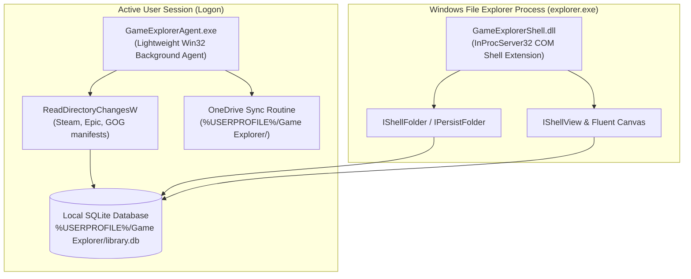

# Windows Game Explorer — Startup Background Service Architecture Spike

> Research and architecture spike for Phase 1 of Windows Game Explorer (W.54 / v2.0.0).
> Evaluates startup lifecycle models, directory monitoring, and session scoping.
>
> **Status: superseded by a user decision on 2026-10-25 — see §0.** The evaluation below is kept for
> its analysis of Session 0 isolation and IPC; its recommendation (§3, per-user agent) is no longer the
> chosen design.

---

## 0. Decision (2026-10-25)

The background component is a **true Windows service**, named **Game Explorer Service**:

| Decision | Value |
| --- | --- |
| Host model | Windows service (`SERVICE_WIN32_OWN_PROCESS`) installed through the Service Control Manager |
| Account | **`NT AUTHORITY\LocalService`** — least privilege; `LocalSystem` rejected |
| Startup orchestration | **Task Scheduler** bootstrap task registered by the elevated installer, so the service is installed/started/restarted with **no UAC prompt** after installation |
| Executable | `GameExplorerService.exe` |
| Service key / display name | `GameExplorerService` / "Game Explorer Service" |
| Consumers | `GameExplorerShell.dll` (shell view) and `GameExplorerStudio.exe` |
| IPC | Named pipe with an explicit, versioned message schema and a per-session handshake that authenticates the client's user SID |

**Why this overrides the earlier "per-user agent" recommendation.** The service must keep data warm
before any user logs on (boot-time index of installed storefronts) and must survive logoff so the shell
is instantly warm at the next logon. Task Scheduler is used purely as the *startup and privilege
mechanism*: because the installer is already elevated, it can register a highest-privileges task once,
and every later start bypasses UAC entirely. The service is deliberately **not** elevated at runtime and
does **not** run as `LocalSystem`.

**Consequence: Session 0 isolation must be designed for, not avoided.** The service has no interactive
user profile, so:

- Per-user paths (`%USERPROFILE%\Game Explorer\`, `%OneDrive%`, `HKCU`) are resolved per connected client
  session and every write is performed through/beside that client, never against
  `C:\Windows\ServiceProfiles\LocalService`.
- The service treats local metadata JSON as **read-mostly**; the interactive client remains the writer for
  user-editable metadata, and the service only publishes refresh notifications.
- Long-running work (manifest watching, achievement and metadata refresh) is scheduled by the service,
  but any operation that needs the user's token is executed by the client on request.

The IPC surface, privilege boundary, and per-user routing are tracked as `SVC-01` in
[`TODO.md`](../../TODO.md).

---

## 1. Requirements & Problem Statement

To deliver a truly native, instant-response Windows experience, the application requires:
1. **Silent Startup Execution:** Starts automatically when Windows boots or user logs in, without popping up a console window or stealing focus.
2. **Automated Directory Monitoring:** Monitors storefront manifest folders (Steam `libraryfolders.vdf`, Epic manifests, GOG SQLite) in real time using `ReadDirectoryChangesW`, keeping the local database current.
3. **OneDrive Cloud Sync Synchronization:** Runs automated backup routines into the user's local OneDrive folder with sync readiness validation.
4. **Instant In-Shell Responsiveness:** When a user clicks "Game Explorer" in the File Explorer sidebar, `IShellView` must read from an already-current in-memory / local SQLite cache without waiting for disk crawlers.
5. **Multi-User Isolation:** Each Windows user account must have its own isolated library rooted under `%USERPROFILE%\Game Explorer\`.

---

## 2. Evaluation of Architectural Options

### Option A: Windows Service via Service Control Manager (SCM)
- **Mechanism:** Standard Windows Service installed into SCM (`services.msc`).
- **Challenges:**
  - Since Windows Vista, all Windows Services run in **Session 0** under `LocalSystem`, `LocalService`, or `NetworkService`.
  - Session 0 isolation prevents direct access to the logged-in user's `HKCU` registry, `%USERPROFILE%`, `%OneDrive%`, and mapped drives without complex token impersonation via `WTSQueryUserToken` and `DuplicateTokenEx`.
  - Multi-user scenarios become overly complex because a system service must detect user logons/logoffs and spawn impersonated threads for each user.
- **Verdict:** **CHOSEN (2026-10-25) under `LocalService` with a Task Scheduler bootstrap** — see §0. The
  Session 0 costs above are accepted and explicitly designed for: the service owns the shared cache and
  scheduling, while per-user writes are routed through the connected client session. The service is not
  elevated at runtime, and the elevated installer registers the bootstrap task once so later starts never
  prompt for UAC.

---

### Option B: User-Session Background Agent (`HKCU\...\Run` or Task Scheduler)
- **Mechanism:** Lightweight native Win32 executable (`GameExplorerAgent.exe`) launched at user logon via `HKCU\Software\Microsoft\Windows\CurrentVersion\Run` or a Windows Task Scheduler logon trigger.
- **Characteristics:**
  - Runs with the active user's standard security token.
  - Native access to `%USERPROFILE%`, `%OneDrive%`, and `HKCU` with zero permission hurdles.
  - Spawns as a headless message-only window (`HWND_MESSAGE`) consuming < 5MB of RAM.
  - Multi-user isolation is automatic: each user runs their own instance when logged in.
- **Verdict:** **HIGHLY SUITABLE** for user-scoped background monitoring.

---

### Option C: Pure In-Process Shell Extension (Lazy Scanning Only)
- **Mechanism:** Shell extension DLL (`GameExplorerShell.dll`) loaded into `explorer.exe` via `InProcServer32`. Crawls directories on demand when the user opens the virtual folder.
- **Challenges:**
  - Cold navigation to Game Explorer can stutter if scanning thousands of titles across multiple drives.
  - No background directory watching or scheduled OneDrive cloud backups when File Explorer is closed.
- **Verdict:** **INSUFFICIENT ON ITS OWN** for automated continuous indexing.

---

## 3. Recommended Architecture: Hybrid In-Process Shell + User-Session Agent (superseded — see §0)

The optimal, most native Windows design is a **hybrid dual-component architecture**:

1. **`GameExplorerAgent.exe` (User-Session Background Service):**
   - Headless Win32 application registered in `HKCU\...\Run`.
   - Uses `ReadDirectoryChangesW` on store folders to catch game installs/uninstalls immediately.
   - Executes periodic OneDrive backup checks.
   - Writes directly to `%USERPROFILE%\Game Explorer\library.db`.
2. **`GameExplorerShell.dll` (InProcServer32 COM Extension):**
   - Registered under CLSID as a Virtual Shell Namespace Extension.
   - When opened in File Explorer, directly reads the pre-indexed SQLite cache.
   - Zero UI blocking, instant display of thousands of games.
