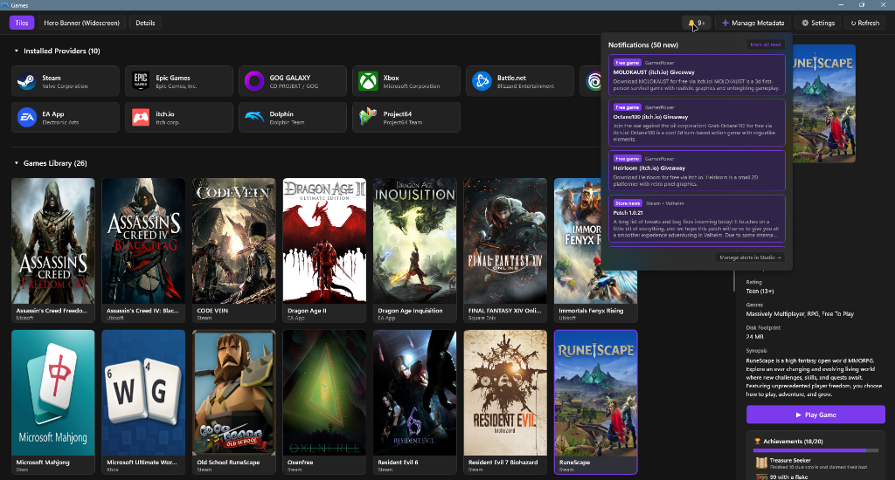

# Update Alerts & Notification Bell

> How Windows Game Explorer decides whether an installed game is current, where the alerts come
> from, and what the bell in the Game Catalogue header collects.

Two related features cooperate:

1. **The per-game update checker** compares each *installed* edition against the build its own
   storefront publishes. Results appear in the Game Catalogue details pane.
2. **The notification bell** collects update verdicts, storefront news, free games and promotions
   into one list behind the bell button.

Both run inside the background service once per sign-in. Neither polls continuously.

---

## 🔄 The per-game update checker

### What "up to date" means

The check always uses **the storefront the game was installed through**, never a different store
that happens to sell the same title:

| Storefront | Source of truth | Verdict |
|---|---|---|
| **Steam** | Official keyless `ISteamApps/UpToDateCheck` endpoint, called with the `buildid` from `appmanifest_<appId>.acf` | *Up to date*, or *Update available* with the installed and required build ids |
| **GOG Galaxy** | `buildId` in the game's `goggame-*.info` file, compared with Galaxy's `ImportedLatestBuildIds` cache | *Up to date*, *Update available*, or *Not supported* when Galaxy has never imported a latest build |
| **Epic Games** | `AppVersionString` from the `.item` manifest | Installed version is shown; verdict is *Not supported* |
| **Xbox / Microsoft Store** | Installed package version | Installed version is shown; verdict is *Not supported* |
| **Everything else** | — | *Not supported* |

> **Why so cautious?** Steam publishes an official "is my build current?" endpoint. GOG Galaxy
> leaves comparable build identities in its local database. Epic and Xbox publish no public
> comparison endpoint, so Game Explorer shows what is installed and says the comparison is
> unsupported instead of guessing. A check that cannot answer never reports "up to date".

Two more invariants:

- **Only installed editions are checked.** An owned-but-uninstalled title has no installed build to
  compare, so it never touches the network.
- **No installed build id, no request.** If the local manifest carries no build id, the edition is
  skipped rather than asked about with an empty version.

### Where the verdict appears

In the Game Catalogue details pane, each owned-edition card shows the verdict together with the
installed build (when the storefront exposes one) and its **Store page** button:

```text
Steam · Installed
Installed build 11138802
Update available · latest 11138805
[ Store page ]
```

The pane reads a cache, so it renders instantly and never blocks on HTTP.

### When checks run

| Trigger | Detail |
|---|---|
| Service start | The first full pass runs as soon as `GameExplorerService` starts |
| Interactive logon / unlock | `WTSRegisterSessionNotification` re-runs the pass for the signed-in user |
| **Check for alerts now** | One immediate pass, requested from Configuration card 6 |

A burst of requests cannot pile up: the service keeps at most one pending refresh and joins the
active scan instead of interrupting it.

### The cached result

`%LOCALAPPDATA%\Game Explorer\updates.json` stores one report per installed edition — the storefront,
the installed and latest build ids, the verdict and the storefront's own message. The file is
lenient to read: if it is missing, empty or truncated, the catalogue simply shows no verdict and the
next pass rewrites it.

---

## 🔔 The notification bell

The bell sits in the File Explorer Games command bar and in the Game Catalogue header (left of **Refresh Catalogue**). A badge shows the unread count, capped at `9+`. Clicking it opens an in-view alert flyout panel; the bell glyph turns accent-coloured while the panel is open.



<br />

### What the panel contains

Each alert shows its kind label, its source, a title, a short plain-text summary and a timestamp:

| Kind | Label | Produced when |
|---|---|---|
| Game update | **Update available** | An installed edition has a newer build on its own storefront |
| Storefront news | **Store news** | A storefront feed has an item from the last 30 days |
| Free game | **Free game** | GamerPower lists a full game giveaway |
| Promotion | **Deal & promotion** | GamerPower lists loot or a beta key |

Alerts are sorted newest first and de-duplicated by a stable id per source, so the same giveaway
never appears twice in one feed.

### What you can do

- **Click an alert** — marks it read and opens its page in your browser (the store page, the news
  post, or the giveaway page).
- **Mark all read** (panel footer) — clears the badge. Read state is persisted.
- **Dismiss the panel** — click the bell again, click the page background, or press `Esc`.
- **Scroll** — mouse wheel, the scroll rail, keyboard (`Up`/`Down`/`Page Up`/`Page Down`/`Home`/`End`),
  or drag the thumb.

Read state lives in `%LOCALAPPDATA%\Game Explorer\notifications-seen.json` as a flat list of alert
ids. A refresh never resurrects an alert you already read, and ids that disappear from the feed are
pruned so the file cannot grow without bound. Deleting the file marks everything unread again.

---

## 📡 Alert sources and what leaves your machine

| Source | Endpoint | Enabled by |
|---|---|---|
| Steam build check | `api.steampowered.com/ISteamApps/UpToDateCheck/v1` | **Game update alerts** |
| Steam announcements | `api.steampowered.com/ISteamNews/GetNewsForApp/v2` (`steam_community_announcements`), per owned game | **Storefront news** + **Steam** |
| GOG news | `gog.com/news/feed` | **Storefront news** + **GOG** |
| Epic Games Store blog | `store-content.ak.epicgames.com/api/en-US/content/blog` | **Storefront news** + **Epic** |
| Xbox Wire news | `news.xbox.com/feed/` | **Storefront news** + **Xbox** |
| Free games & deals | `gamerpower.com/api/giveaways?platform=pc` | **Free full games** / **Deals, loot & beta keys** |

All of these are **public, keyless** endpoints. No storefront account, session token or API key is
used for update and alert collection, and no storefront file is ever modified. Your Steam Web API
key and other credentials are used only for achievements and artwork — never for alert fetching.

News items are limited to the **last 30 days**. Active giveaways are shown regardless of age,
because a giveaway stops being returned by GamerPower when it expires.

> **Attribution:** free-game and deal data is provided by [GamerPower](https://www.gamerpower.com/).
> The panel always renders an active hyperlink back to GamerPower.com, as their API terms require.

### Offline and failure behaviour

Every parser drops the individual item it cannot understand instead of failing the whole pass.
Missing network connectivity therefore produces a smaller feed, never an error dialog or a stuck
catalogue. A failed update check leaves the previous verdict in place.

---

## ⚙️ Turning alerts on and off

Configuration card 6 (**Game Catalogue Notification Bell**) owns eight switches, all default **on**:

| Switch | Stored key | Effect |
|---|---|---|
| Game update alerts (installed editions with a newer build) | `notify_game_updates` | Adds/removes **Update available** alerts |
| Storefront news | `notify_news` | Master switch for the four news feeds |
| Steam / GOG / Epic / Xbox | `notify_news_steam`, `notify_news_gog`, `notify_news_epic`, `notify_news_xbox` | Per-storefront news; enabled only while **Storefront news** is on |
| Free full games (GamerPower) | `notify_free_games` | **Free game** alerts |
| Deals, loot & beta keys (GamerPower) | `notify_promotions` | **Deal & promotion** alerts |

Process:

1. Clear the switches you do not want.
2. Click **Save Configuration**.
3. Click **Check for alerts now** to rebuild the feed immediately, or wait for the next sign-in.

Turning a source off removes its items from the next feed pass. It does not delete alerts already
cached until the next refresh runs.

---

## 🧭 What the bell deliberately does not do

- **No background polling.** One pass per sign-in plus explicit manual checks. There is no timer,
  no push channel, and no periodic network traffic.
- **No patch notes.** Storefront news is general news from the store's own feed, not per-game
  changelogs — no storefront offers a public changelog endpoint for arbitrary titles.
- **No review feeds, no sales aggregators beyond GamerPower.** Adding more sources would require
  keys or scraping, both of which are out of scope.
- **No auto-install of game updates.** It reports; you update through the storefront client.
- **No silent telemetry.** The only requests are the endpoints in the table above.

---

## 🩺 Troubleshooting the bell and verdicts

| Symptom | Explanation | Fix |
|---|---|---|
| Badge stays empty, status says "No refresh yet." | The service has not completed a pass for this user yet | Start `GameExplorerService`, or click **Check for alerts now** |
| Status label shows a refresh stamp but only a few alerts | Sources you disabled, or no news in the last 30 days | Re-enable the switches and refresh |
| A game shows *Not supported* | Epic/Xbox have no public build comparison; GOG never imported the latest build | Update through the storefront client; the verdict is informational |
| A Steam game shows *Update available* but Steam says it is current | Steam's endpoint reflects the public branch, and can lag behind a client-side beta branch | Trust your client for beta branches |
| A cached alert opens the wrong page | The storefront changed the item's URL after publication | **Mark all read**, then refresh to rebuild |
| Deleting alerts did not "unread" them | Read state, not the feed, is the source of truth | Delete `notifications-seen.json` |

More general symptoms: [Troubleshooting](./troubleshooting.md).

---

## See also

- [Configuration](./configuration.md#6-game-catalogue-notification-bell) — the settings card.
- [User Guide — Game Catalogue](./user-guide.md#2-game-catalogue-page-gameexplorerstudioexe) — details pane and installing.
- [Developer: catalogue internals](../developer/catalogue-internals.md) — feed model, JSON shapes and parsers.
